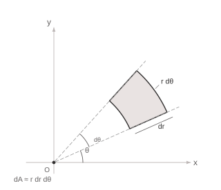
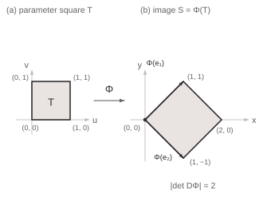
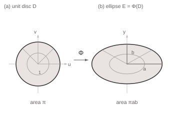

## Substitution in one dimension

The one-dimensional substitution rule rewrites an integral under a change of variable. If $g:[a,b]\to\mathbb{R}$ is continuously differentiable and $f$ is continuous on the image, then

$$\int_{g(a)}^{g(b)}f(x)\,dx=\int_a^b f(g(t))\,|g'(t)|\,dt \tag{1}$$

The absolute value is needed when $g$ is decreasing, because the orientation of the interval is reversed. The factor $|g'(t)|$ measures how much the map stretches length near $t$: a small interval of length $dt$ is carried to an interval of approximate length $|g'(t)|\,dt$.

In several variables, a change of coordinates is a map $\Phi$ from one open set to another. The derivative is a matrix, and the local stretching of volume is measured by its determinant. The determinant can be positive or negative, so the formula contains its absolute value. This is the content of the change-of-variables theorem.

## The theorem

Let $U,V\subseteq\mathbb{R}^n$ be open, and let $\Phi:U\to V$ be a bijection of class $C^1$ with

$$\det D\Phi(u)\neq0 \qquad\text{for every }u\in U \tag{2}$$

Let $T\subseteq U$ be a compact measurable set and let $S=\Phi(T)$. If $f$ is integrable on $S$, then $f\circ\Phi$ is integrable on $T$, and

$$\int_S f(x)\,dx=\int_T f(\Phi(u))\,|\det D\Phi(u)|\,du \tag{3}$$

The left-hand integral is over the original region $S$ in the $x$-coordinates; the right-hand integral is over the parameter region $T$ in the $u$-coordinates. In two and three dimensions, (3) is written

$$\iint_S f(x,y)\,dx\,dy=\iint_T f(\Phi(u,v))\,\left|\frac{\partial(x,y)}{\partial(u,v)}\right|du\,dv \tag{4}$$

$$\iiint_S f(x,y,z)\,dx\,dy\,dz=\iiint_T f(\Phi(u,v,w))\,\left|\frac{\partial(x,y,z)}{\partial(u,v,w)}\right|du\,dv\,dw \tag{5}$$

where the Jacobian determinants are

$$\frac{\partial(x,y)}{\partial(u,v)}=\det\begin{pmatrix}x_u&x_v\\ y_u&y_v\end{pmatrix} \qquad \frac{\partial(x,y,z)}{\partial(u,v,w)}=\det\begin{pmatrix}x_u&x_v&x_w\\ y_u&y_v&y_w\\ z_u&z_v&z_w\end{pmatrix}$$

The notation suppresses the argument $u$ in the derivatives; each partial derivative is evaluated at the corresponding point of $T$.

The hypotheses deserve comment. The map must be a bijection between open sets, not merely injective on $T$; this ensures that every point of $S$ has exactly one preimage in $U$ and that the inverse is defined on an open set. The condition $\det D\Phi\neq0$ makes $\Phi$ a local diffeomorphism at every point, by the [inverse function theorem](../inverse-function-theorem/). The compactness and measurability of $T$ ensure that the integrals exist and that the boundary can be neglected. In practice, a map that is injective on the interior of $T$ except on a set of zero content, and whose Jacobian vanishes only on that set, is admissible; the theorem is usually applied in this slightly extended form.

If $\Phi$ is only piecewise $C^1$, or if the region must be split into pieces on which $\Phi$ is injective, the formula is applied separately to each piece and the results are added. The boundary between pieces has zero content and contributes nothing.

## Why the Jacobian appears

The determinant enters through the action of the derivative on small volumes. For an invertible linear map $A:\mathbb{R}^n\to\mathbb{R}^n$ and a measurable set $E$, the volume scales by the absolute determinant:

$$\operatorname{vol}(A(E))=|\det A|\,\operatorname{vol}(E) \tag{6}$$

This is the geometric meaning of the determinant. In one dimension it reduces to the stretching factor $|A|$; in two dimensions it is the area of the parallelogram spanned by the images of the standard basis vectors; in three dimensions it is the volume of the corresponding parallelepiped.

For a nonlinear map, the derivative is almost linear on a sufficiently small piece. Partition $T$ into small cubes $C_k$ of side $h$ with centres $u_k$. On $C_k$,

$$\Phi(u)\approx\Phi(u_k)+D\Phi(u_k)(u-u_k)$$

so the image is approximately a parallelepiped whose volume is

$$|\det D\Phi(u_k)|\,\operatorname{vol}(C_k)=|\det D\Phi(u_k)|\,h^n$$

Summing $f(\Phi(u_k))$ times this volume gives the Riemann sum

$$\sum_k f(\Phi(u_k))\,|\det D\Phi(u_k)|\,h^n$$

which converges to the right-hand side of (3) as $h\to0$. The approximation error is controlled by the uniform continuity of $D\Phi$ on compact subsets of $U$. A complete proof quantifies this error, shows that the images of the small cubes cover $S$ without essential overlap, and passes to the limit. The argument is a local linearisation followed by a Riemann-sum limit, not a formal manipulation of differentials.

The one-dimensional case is instructive. There $D\Phi(t)=\Phi'(t)$ is a $1\times1$ matrix, its determinant is $\Phi'(t)$, and (3) becomes (1). The condition $\Phi'\neq0$ ensures that $\Phi$ is strictly monotone, hence injective, on each interval where the formula is applied.

## Polar, cylindrical and spherical coordinates

The most important applications are the coordinate systems that exploit symmetry. Each is a map from a parameter region to the original region, and each has a Jacobian that can be computed directly.

## Polar coordinates

The map

$$x=r\cos\theta \qquad y=r\sin\theta$$

has Jacobian matrix

$$D\Phi(r,\theta)=\begin{pmatrix}\cos\theta&-r\sin\theta\\ \sin\theta&r\cos\theta\end{pmatrix}$$

and determinant

$$\det D\Phi=r\cos^2\theta+r\sin^2\theta=r$$

Hence $dx\,dy=r\,dr\,d\theta$, the area element used in the entry on [polar coordinates](../polar-coordinates/). The map is a bijection from $(0,\infty)\times(0,2\pi)$ onto the plane minus the nonnegative $x$-axis; the missing ray and the origin have zero area, so they do not affect integrals over regions whose boundary is not pathological.

## Cylindrical coordinates

The map

$$x=r\cos\theta \qquad y=r\sin\theta \qquad z=z$$

adds an unchanged vertical coordinate to the polar map. Its Jacobian matrix is block triangular,

$$D\Phi(r,\theta,z)=\begin{pmatrix}\cos\theta&-r\sin\theta&0\\ \sin\theta&r\cos\theta&0\\ 0&0&1\end{pmatrix}$$

so the determinant is again $r$. Therefore

$$dx\,dy\,dz=r\,dr\,d\theta\,dz \tag{7}$$

The entry on [cylindrical coordinates](../cylindrical-coordinates/) develops the geometry and the typical regions; the factor $r$ is the Jacobian of this map.

## Spherical coordinates

With $\rho\ge0$ the distance from the origin, $\theta$ the azimuthal angle in the $xy$-plane, and $\varphi\in[0,\pi]$ the angle from the positive $z$-axis,

$$x=\rho\sin\varphi\cos\theta \qquad y=\rho\sin\varphi\sin\theta \qquad z=\rho\cos\varphi$$

The Jacobian matrix is

$$D\Phi(\rho,\theta,\varphi)=\begin{pmatrix}\sin\varphi\cos\theta&-\rho\sin\varphi\sin\theta&\rho\cos\varphi\cos\theta\\ \sin\varphi\sin\theta&\rho\sin\varphi\cos\theta&\rho\cos\varphi\sin\theta\\ \cos\varphi&0&-\rho\sin\varphi\end{pmatrix}$$

Expanding the determinant gives

$$\det D\Phi=-\rho^2\sin\varphi \tag{8}$$

The determinant is negative with this column order because the ordered coordinates $(\rho,\theta,\varphi)$ are left-handed. Its absolute value is $\rho^2\sin\varphi$, which is nonnegative on the stated range. Hence

$$dx\,dy\,dz=\rho^2\sin\varphi\,d\rho\,d\theta\,d\varphi \tag{9}$$

The entry on [spherical coordinates](../spherical-coordinates/) treats the geometry and the integration limits. The convention for $\varphi$ matters: here $\varphi$ is measured from the positive $z$-axis, not from the $xy$-plane, and some texts use the opposite convention or the letter $\psi$. The Jacobian is the same in either convention once the range of the angle is adjusted.

## Affine maps and a shear

A linear or affine map is the simplest case, and it already shows the role of the determinant.

Let $T=[0,1]^2$ and define

$$\Phi(u,v)=(u+v,\ u-v)$$

The derivative is the constant matrix

$$D\Phi=\begin{pmatrix}1&1\\ 1&-1\end{pmatrix} \qquad \det D\Phi=-2$$

The image $S=\Phi(T)$ is the square with vertices $(0,0)$, $(1,1)$, $(2,0)$ and $(1,-1)$. Its side length is $\sqrt2$, so its area is $2$. Formula (6) gives

$$\operatorname{area}(S)=|\det D\Phi|\operatorname{area}(T)=2$$

which agrees. For a function on $S$, (4) reads

$$\iint_S f(x,y)\,dx\,dy=\iint_T f(u+v,u-v)\cdot2\,du\,dv$$

For example, with $f(x,y)=x$,

$$\iint_S x\,dx\,dy=2\int_0^1\int_0^1(u+v)\,du\,dv=2\left(\frac12+\frac12\right)=2$$

The centroid of $S$ is $(1,0)$ and its area is $2$, so the direct computation also gives $1\cdot2=2$. The factor $2$ is the area distortion of the map; the sign of the determinant is irrelevant because the formula uses its absolute value.

## An ellipse

Let

$$E=\left\{(x,y):\frac{x^2}{a^2}+\frac{y^2}{b^2}\le1\right\}$$

with $a,b>0$. The map

$$x=au \qquad y=bv$$

carries the unit disc $D=\{u^2+v^2\le1\}$ onto $E$. Its Jacobian determinant is $ab$, so

$$\operatorname{area}(E)=\iint_D ab\,du\,dv=ab\,\pi$$

The area of the ellipse is therefore $\pi ab$, a result that is awkward to obtain from Cartesian limits and immediate from the change of variables.

The same map evaluates moments. For instance,

$$\iint_E x^2\,dx\,dy=\iint_D (au)^2\,ab\,du\,dv=a^3b\iint_D u^2\,du\,dv$$

In polar coordinates on the unit disc,

$$\iint_D u^2\,du\,dv=\int_0^{2\pi}\int_0^1 r^2\cos^2\theta\,r\,dr\,d\theta=\left(\int_0^{2\pi}\cos^2\theta\,d\theta\right)\left(\int_0^1r^3\,dr\right)=\pi\cdot\frac14=\frac{\pi}{4}$$

Hence

$$\iint_E x^2\,dx\,dy=\frac{\pi a^3b}{4}$$

The result is dimensionally consistent: it scales like length to the fourth power, as an integral of $x^2$ over an area must.

## When the formula fails

The hypotheses are not cosmetic. Three failures illustrate what can go wrong.

**Non-injectivity.** Let $\Phi(u,v)=(u^2,v)$ on $T=[-1,1]\times[0,1]$. The image is $S=[0,1]\times[0,1]$, and the Jacobian determinant is $2u$. The map is two-to-one on the interior of $T$: the points $(u,v)$ and $(-u,v)$ have the same image. Formula (3) would give

$$\iint_T 1\cdot|2u|\,du\,dv=2\int_{-1}^1|u|\,du=2$$

while the area of $S$ is $1$. The discrepancy is exactly the multiplicity of the map: the integral over $T$ counts each point of $S$ twice. The theorem does not apply because $\Phi$ is not injective. If the target integral is computed with multiplicity, the formula remains valid; for an ordinary integral over $S$, the map must be restricted to a branch on which it is injective.

**A vanishing Jacobian.** The same map has $\det D\Phi=0$ on the line $u=0$. The inverse function theorem fails there, and the map is not a local diffeomorphism along that line. A map with a vanishing Jacobian can still be injective, but the formula is no longer guaranteed by the theorem. The safe procedure is to split the region, restrict to a branch, or verify the conclusion directly.

**A missing absolute value.** Let $\Phi(u,v)=(u,-v)$ on the unit square. The determinant is $-1$. If the absolute value were omitted, the area formula would give $-1$ for the area of the image, which is impossible. The sign records orientation reversal, not negative area. The same issue occurs in one dimension when $g$ is decreasing.

A fourth failure is analytic rather than geometric: a map that is continuous but not $C^1$ can distort a region so badly that the formula fails even though the Jacobian exists almost everywhere. The hypothesis of class $C^1$ excludes such maps. The theorem is not a statement about arbitrary substitutions; it is a statement about differentiable coordinate changes.

## Relation to the inverse function theorem

The change-of-variables theorem and the [inverse function theorem](../inverse-function-theorem/) describe two sides of the same local picture. The inverse function theorem says that a $C^1$ map with invertible derivative is locally a diffeomorphism. The change-of-variables theorem says that such a diffeomorphism distorts volumes by the absolute determinant of its derivative.

The two are consistent under composition. If $\Phi$ and $\Psi$ are admissible changes of variables, then

$$\det D(\Phi\circ\Psi)(u)=\det D\Phi(\Psi(u))\,\det D\Psi(u)$$

by the chain rule, and the absolute values multiply. Applying the formula in two steps gives the same result as applying it once. For the inverse map,

$$\det D\Phi^{-1}(x)=\frac{1}{\det D\Phi(\Phi^{-1}(x))}$$

so changing coordinates and then changing back recovers the original integral. These identities are algebraic checks on the formula; they do not replace the proof, but they show that the Jacobian factor is forced by the way determinants behave under composition.

## Summary of the procedure

To evaluate an integral by a change of variables:

+ choose a map $\Phi$ whose image is the region and whose parameter region has simple limits;
+ compute the Jacobian determinant and take its absolute value;
+ express the integrand in the new variables;
+ replace $dx\,dy$ or $dx\,dy\,dz$ by the Jacobian times $du\,dv$ or $du\,dv\,dw$;
+ check that $\Phi$ is injective on the interior of the parameter region, or split the region into branches;
+ evaluate the resulting integral by [Fubini's theorem](../fubinis-theorem/).

The procedure is the multivariable form of substitution. Its geometric content is that volume is not preserved by a nonlinear map, and that the local distortion is measured by the determinant of the derivative.
