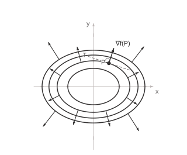
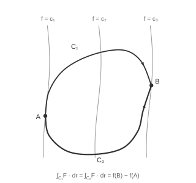
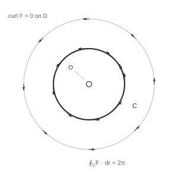

## A field that is a gradient

A vector field is often introduced as an assignment of an arrow to each point, without any claim that the arrows come from a scalar function. The gravitational and electrostatic fields are different: each is the gradient of a scalar potential, and this additional structure determines the work done along a path before the path is chosen.

Let $D$ be an open connected subset of $\mathbb{R}^2$ or $\mathbb{R}^3.$ A continuous vector field $\mathbf{F}$ on $D$ is **conservative** if there exists a scalar function $f$ on $D$ such that

$$\mathbf{F}=\nabla f \qquad \text{on } D \tag{1}$$

The function $f$ is a **potential function** for $\mathbf{F}.$ The defining equation is local, but its consequences are global: the line integral of $\mathbf{F}$ between two points depends only on those points.

The gravitational field of a point mass at the origin is the standard example. With $G$ the gravitational constant and $M$ the mass,

$$\mathbf{F}(\mathbf{r})=-\frac{GM}{r^3}\,\mathbf{r} \qquad r=\lVert\mathbf{r}\rVert \tag{2}$$

and

$$f(\mathbf{r})=\frac{GM}{r} \qquad \nabla f=-\frac{GM}{r^3}\,\mathbf{r} \tag{3}$$

so the field is conservative on $\mathbb{R}^3\setminus\{\mathbf{0}\}.$ The function $f$ decreases with distance, while the force points inward. The potential energy $-GMm/r$ increases with distance, which is why a raised body stores energy.

Not every field has this form. The rotational field

$$\mathbf{F}(x,y)=\langle-y,x\rangle \tag{4}$$

circulates around the origin. If $\mathbf{F}=\nabla f,$ then $f_x=-y$ and $f_y=x.$ Integrating the first equation gives $f=-xy+\phi(y),$ and differentiating with respect to $y$ gives $-x+\phi'(y)=x,$ which requires $\phi'(y)=2x.$ The left side depends only on $y$ and the right side only on $x,$ so no such $f$ exists. The field is not conservative on $\mathbb{R}^2.$

## Potentials are unique up to a constant

Suppose that $f$ and $g$ are both potentials for $\mathbf{F}$ on $D.$ Then $\nabla(f-g)=\mathbf{0}$ on $D.$ A function with zero gradient on a connected open set is constant, so $f-g=C$ for some constant $C.$

The constant has no physical meaning. It cancels from every difference $f(B)-f(A)$ and therefore from every line integral. Setting $f(P_0)=0$ at a chosen reference point fixes the constant when a numerical potential is wanted. On a disconnected domain the situation is slightly different: the difference $f-g$ can take a different constant on each connected component, because the gradient condition gives no information linking separate components.

The level sets $f(x,y)=c$ are called equipotential curves, and in space equipotential surfaces. Where $\nabla f\neq\mathbf{0},$ the gradient is orthogonal to the level set through the point. If $\mathbf{r}(t)$ stays on a level set, then $f(\mathbf{r}(t))$ is constant, so

$$\frac{d}{dt}f(\mathbf{r}(t))=\nabla f(\mathbf{r}(t))\cdot\mathbf{r}'(t)=0 \tag{5}$$

Hence the field arrows cross the level sets at right angles. They point toward increasing $f,$ and their length $\lVert\nabla f\rVert$ is large where the level sets are close together. A topographic map with its steepest-ascent arrows is the two-dimensional picture.

## Path independence

Let $C$ be a piecewise smooth curve in $D$ from $A$ to $B,$ parameterized by $\mathbf{r}(t)$ for $a\le t\le b.$ If $\mathbf{F}=\nabla f,$ then the chain rule gives

$$\frac{d}{dt}f(\mathbf{r}(t))=\nabla f(\mathbf{r}(t))\cdot\mathbf{r}'(t)=\mathbf{F}(\mathbf{r}(t))\cdot\mathbf{r}'(t) \tag{6}$$

Integrating from $a$ to $b$ and applying the fundamental theorem of calculus,

$$\int_C\mathbf{F}\cdot d\mathbf{r}=f(\mathbf{r}(b))-f(\mathbf{r}(a))=f(B)-f(A) \tag{7}$$

The right side depends only on the endpoints. For a piecewise smooth curve the argument is applied to each smooth piece, and the values at the intermediate points cancel.

Two immediate consequences follow. First, the integral of a conservative field is **path-independent**: any two piecewise smooth curves in $D$ with the same initial and terminal points give the same value. Second, the integral around every closed piecewise smooth curve in $D$ is zero, because the initial and terminal points coincide.

The converse is also true, and it is what makes the definition useful as a test. Suppose that $\mathbf{F}$ is continuous on an open connected $D$ and that its line integral is path-independent. Fix a base point $P_0\in D$ and define

$$f(P)=\int_{P_0}^{P}\mathbf{F}\cdot d\mathbf{r} \tag{8}$$

where the integral is taken along any piecewise smooth path in $D$ from $P_0$ to $P.$ Path-independence makes $f$ well defined. To see that $\nabla f=\mathbf{F},$ move from $P=(x,y)$ a short distance $h$ in the $x$-direction. The difference quotient is the integral along the horizontal segment from $(x,y)$ to $(x+h,y),$ divided by $h;$ as $h\to0$ it tends to the $x$-component of $\mathbf{F}$ at $P$ by continuity. The same argument in the other coordinates gives $\nabla f=\mathbf{F}.$

Hence, on an open connected domain, a continuous field is conservative if and only if its line integral is path-independent. Equivalently, it is conservative if and only if its integral around every closed curve in the domain is zero. The proof of the last equivalence joins two paths from $A$ to $B$ into a closed loop, and splits a closed loop at any point into two paths.

## The local test

The definition asks for a potential, which is a global object. A differential test is available because a gradient field has vanishing curl. Let $\mathbf{F}=\langle P,Q\rangle$ be of class $C^1$ on $D,$ and suppose that $\mathbf{F}=\nabla f$ with $f$ of class $C^2.$ Then

$$\frac{\partial Q}{\partial x}=\frac{\partial^2 f}{\partial x\,\partial y}=\frac{\partial^2 f}{\partial y\,\partial x}=\frac{\partial P}{\partial y} \tag{9}$$

by equality of the mixed partials. The scalar curl is therefore zero:

$$\frac{\partial Q}{\partial x}-\frac{\partial P}{\partial y}=0 \tag{10}$$

In space, with $\mathbf{F}=\langle P,Q,R\rangle,$ the same argument gives the three cross-partial identities

$$P_y=Q_x \qquad P_z=R_x \qquad Q_z=R_y \tag{11}$$

which are exactly the three components of $\operatorname{curl}\mathbf{F}=\mathbf{0}.$

A nonzero curl therefore certifies that a field is not conservative. The converse is subtler. If $D$ is **simply connected**, meaning that every closed curve in $D$ can be contracted continuously to a point while staying in $D,$ and $\mathbf{F}$ is $C^1$ with zero curl on $D,$ then $\mathbf{F}$ is conservative on $D.$

The standard proof in the plane uses Green's theorem. Take two paths from $A$ to $B$ that, together, bound a region $R$ contained in $D.$ Then

$$\oint_{\partial R}P\,dx+Q\,dy=\iint_R\left(\frac{\partial Q}{\partial x}-\frac{\partial P}{\partial y}\right)dA=0 \tag{12}$$

so the two paths give the same integral. For an arbitrary pair of paths the enclosed region may not lie in $D,$ and one subdivides the region or uses a limiting argument; simple connectedness is what guarantees that the obstruction cannot occur. In space the proof is analogous, using Stokes' theorem on a surface bounded by the two paths. A full proof for every simply connected domain is a topological argument and is usually quoted rather than reproduced in a first course.

The hypotheses matter. The field must be $C^1$ so that the curl exists and is continuous. The domain must be open and connected so that a potential can be differentiated and the additive constant is the only ambiguity. Simple connectedness is a hypothesis on the domain, not on the field, and it cannot be checked by looking at $\mathbf{F}$ alone.

## The punctured plane

The standard counterexample to the converse on a non-simply-connected domain is

$$\mathbf{F}(x,y)=\left\langle-\frac{y}{x^2+y^2},\ \frac{x}{x^2+y^2}\right\rangle \tag{13}$$

on $D=\mathbb{R}^2\setminus\{(0,0)\}.$ A direct differentiation gives

$$\frac{\partial Q}{\partial x}=\frac{\partial P}{\partial y}=\frac{y^2-x^2}{(x^2+y^2)^2} \tag{14}$$

so the scalar curl vanishes at every point of $D.$ Nevertheless, on the unit circle $\mathbf{r}(t)=\langle\cos t,\sin t\rangle,$

$$\int_C\mathbf{F}\cdot d\mathbf{r}=\int_0^{2\pi}\frac{\sin^2t+\cos^2t}{\cos^2t+\sin^2t}\,dt=2\pi \tag{15}$$

The integral around a closed curve is nonzero, so the field is not conservative on the punctured plane.

The failure is not a contradiction of the curl test: the domain is not simply connected. The unit circle cannot be contracted to a point without passing through the origin, which is missing from $D.$ On a simply connected subdomain that does not wind around the origin, the same field has a potential. In polar coordinates $x=r\cos\theta,$ $y=r\sin\theta,$ the field is $\langle-\sin\theta/r,\cos\theta/r\rangle=\nabla\theta,$ and $\theta$ is a single-valued function on any domain that avoids a ray from the origin. The potential is therefore a branch of the polar angle, and the $2\pi$ in (15) is the change in that angle around the circle.

The same phenomenon occurs in three dimensions. The field

$$\mathbf{F}(x,y,z)=\left\langle-\frac{y}{x^2+y^2},\ \frac{x}{x^2+y^2},\ 0\right\rangle \tag{16}$$

has zero curl on $\mathbb{R}^3$ minus the $z$-axis, but its circulation around the unit circle in the plane $z=0$ is $2\pi.$ The domain is not simply connected: a loop around the missing axis cannot contract to a point. By contrast, $\mathbb{R}^3$ minus a single point is simply connected, which is why the inverse-square field (2) is conservative on its punctured domain.

## Constructing a potential

On a simply connected domain, a curl-free field has a potential, and the potential can be recovered by integration. In the plane, write $\mathbf{F}=\langle P,Q\rangle$ and integrate $P$ with respect to $x$:

$$f(x,y)=\int P(x,y)\,dx+\phi(y) \tag{17}$$

The integration constant may depend on $y,$ because $y$ is held fixed during the integration. Differentiate the result with respect to $y,$ set it equal to $Q,$ and solve for $\phi'(y).$ One more integration gives $\phi$ up to a constant.

For $\mathbf{F}=\langle e^x\sin y,\ e^x\cos y\rangle,$

$$f=\int e^x\sin y\,dx=e^x\sin y+\phi(y) \tag{18}$$

Then $f_y=e^x\cos y+\phi'(y)=Q=e^x\cos y,$ so $\phi'(y)=0$ and $f=e^x\sin y+C.$ The cross partials agree, $Q_x=e^x\cos y=P_y,$ so the field is conservative on $\mathbb{R}^2.$

In space, with $\mathbf{F}=\langle P,Q,R\rangle,$ integrate $P$ with respect to $x,$ obtaining $f=\int P\,dx+\phi(y,z).$ Differentiating with respect to $y$ and comparing with $Q$ determines $\phi_y,$ and then differentiating with respect to $z$ and comparing with $R$ determines $\phi_z.$ The two partial derivatives of $\phi$ must be compatible, and the curl-free condition is exactly what guarantees that they are.

Consider

$$\mathbf{F}(x,y,z)=\langle 2xy+z^2,\ x^2+3y^2,\ 2xz\rangle \tag{19}$$

The cross partials are $P_y=2x=Q_x,$ $P_z=2z=R_x$ and $Q_z=0=R_y,$ so the field is conservative on $\mathbb{R}^3.$ Integrating the first component,

$$f=\int(2xy+z^2)\,dx=x^2y+xz^2+\phi(y,z) \tag{20}$$

Then

$$f_y=x^2+\phi_y=x^2+3y^2 \qquad f_z=2xz+\phi_z=2xz \tag{21}$$

so $\phi_y=3y^2$ and $\phi_z=0.$ Hence $\phi=y^3+C$ and

$$f(x,y,z)=x^2y+y^3+xz^2+C \tag{22}$$

A direct differentiation confirms the result: $f_x=2xy+z^2,$ $f_y=x^2+3y^2,$ $f_z=2xz.$

The potential gives line integrals without any parameterization. From $A=(0,0,0)$ to $B=(1,1,1),$

$$\int_C\mathbf{F}\cdot d\mathbf{r}=f(1,1,1)-f(0,0,0)=3 \tag{23}$$

along every piecewise smooth path from $A$ to $B.$ A direct check along the segment $\mathbf{r}(t)=\langle t,t,t\rangle$ gives $\mathbf{F}(\mathbf{r}(t))=\langle3t^2,4t^2,2t^2\rangle$ and $\mathbf{r}'(t)=\langle1,1,1\rangle,$ so the integrand is $9t^2$ and the integral is $3.$

## A field that fails the test

The field

$$\mathbf{F}(x,y)=\langle y^2,x\rangle \tag{24}$$

has scalar curl $1-2y,$ which is nonzero except on the line $y=1/2.$ It is therefore not conservative on $\mathbb{R}^2.$ The failure is visible in two integrals from $(0,0)$ to $(1,1).$ Along the parabola $\mathbf{r}(t)=\langle t,t^2\rangle,$

$$\int_{C_1}\mathbf{F}\cdot d\mathbf{r}=\int_0^1(t^4+2t^2)\,dt=\frac15+\frac23=\frac{13}{15} \tag{25}$$

while along the segment $\mathbf{r}(t)=\langle t,t\rangle,$

$$\int_{C_2}\mathbf{F}\cdot d\mathbf{r}=\int_0^1(t^2+t)\,dt=\frac13+\frac12=\frac56 \tag{26}$$

The values differ, so the integral depends on the path. A single point where the curl vanishes does not make the field conservative, because the test is a condition on an open set: the curl must vanish at every point of the domain.

## Conservative forces and energy

The term conservative comes from mechanics. If a force field $\mathbf{F}$ is conservative, write $\mathbf{F}=-\nabla U,$ where $U$ is the potential energy. The work done by the force along a path from $A$ to $B$ is

$$W=\int_C\mathbf{F}\cdot d\mathbf{r}=U(A)-U(B) \tag{27}$$

Only the change in potential energy matters, and the work around a closed path is zero. If a particle of mass $m$ moves under the force alone, its kinetic energy $K=\frac12m\lVert\mathbf{v}\rVert^2$ satisfies $K(B)-K(A)=U(A)-U(B),$ so $K+U$ is constant along the motion. The gravitational potential $U=-GMm/r$ in (2)–(3) is the familiar case: the force is the negative gradient of $U,$ and the total energy is conserved.

A field that is not conservative can still do work, but the work depends on the route, and no scalar energy function records it. The rotational field (4) does positive work along one semicircle from $(1,0)$ to $(-1,0)$ and negative work along the other, so a particle can gain energy by going around a loop. Friction is the usual non-conservative force in mechanics, although it is not a function of position alone and lies outside the scope of this definition.

## What the definition does not say

+ A zero curl is not sufficient on every domain. The punctured-plane field (13) has zero curl everywhere in its domain and is not conservative. The missing hypothesis is simple connectedness, not differentiability.
+ A nonzero curl at a single point rules out a potential on any open domain containing that point, but a field whose curl vanishes at one point and not elsewhere is not conservative either.
+ Path independence is a property of the field together with its domain. Two particular paths with equal integrals do not prove path independence; every pair of paths must agree.
+ A conservative field need not be constant in direction or magnitude. The gravitational field changes direction at every point and is conservative.
+ Zero divergence is a different condition. A field can be divergence-free and curl-free and still fail to be conservative on a domain with a hole, as the punctured-plane example shows.
+ The potential is not uniquely determined. Adding a constant changes $f$ but not $\mathbf{F},$ and no measurement of the field can distinguish the two potentials.
+ A field defined only on a disconnected domain can be conservative with different additive constants on different components. The definition is local on each component, and the constants need not match.

- - -

The curl test is a local certificate with a global hypothesis. On a simply connected domain, zero curl is enough; on a domain with a hole, the circulation around the hole is the obstruction. The next step is the fundamental theorem for line integrals, which turns a potential into a computational tool and explains why conservative fields are the natural setting for work and energy.

## Related notions

Conservative fields are a special class of [vector fields](../vector-fields/), characterized by the existence of a potential function. Their line integrals are governed by the [fundamental theorem for line integrals](../fundamental-theorem-for-line-integrals/), and the local obstruction is the [curl](../curl/); the scalar case in the plane is the integrability condition for an exact differential. The circulation around a hole is measured by [line integrals](../line-integrals/), and the flux analogue of the same obstruction is the [divergence](../divergence/). Gradient fields also appear as normal vectors to level surfaces in the entry on [tangent planes and linear approximations](../tangent-planes-and-linear-approximations/).
