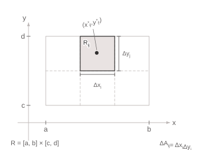
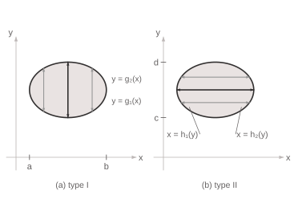
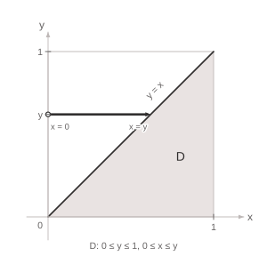

## From area to signed volume

A single integral accumulates a function along an interval. A double integral accumulates a function over a plane region. When the function is nonnegative, the integral is the volume of the solid between the region and the graph of the function; when the function takes both signs, the integral is a signed volume, with the parts below the plane counted negatively.

The construction parallels the one-dimensional Riemann integral. The region is divided into small pieces, the function is evaluated on each piece, and the resulting products are added. Passing to a limit over finer divisions produces the integral, provided the limit does not depend on the choice of sample points.

## The integral over a rectangle

Let $R=[a,b]\times[c,d]$ be a closed rectangle and let $f:R\to\mathbb{R}$ be bounded. A partition of $R$ is obtained by choosing partitions

$$a=x_0<x_1<\cdots<x_m=b \qquad c=y_0<y_1<\cdots<y_n=d$$

The partition divides $R$ into the $mn$ subrectangles

$$R_{ij}=[x_{i-1},x_i]\times[y_{j-1},y_j]$$

whose areas are $\Delta A_{ij}=\Delta x_i\,\Delta y_j$. Choose a sample point $(x_{ij}^*,y_{ij}^*)\in R_{ij}$ in each subrectangle. The associated Riemann sum is

$$S(f,P)=\sum_{i=1}^{m}\sum_{j=1}^{n} f(x_{ij}^*,y_{ij}^*)\,\Delta A_{ij}$$

The mesh of $P$, written $\lVert P\rVert$, is the largest diameter of a subrectangle. The function $f$ is integrable over $R$ if the sums $S(f,P)$ tend to a limit as $\lVert P\rVert\to0$, and if that limit is the same for every choice of sample points. The limit is the double integral

$$\iint_R f(x,y)\,dA=\lim_{\lVert P\rVert\to0}\sum_{i=1}^{m}\sum_{j=1}^{n} f(x_{ij}^*,y_{ij}^*)\,\Delta A_{ij} \tag{1}$$

The notation $dA$ emphasises that the summand carries an area. In Cartesian coordinates one writes $dA=dx\,dy=dy\,dx$, since the area of a small rectangle is the product of its side lengths in either order.

The definition through sample points is equivalent to a definition through lower and upper sums. For a subrectangle $R_{ij}$, let

$$m_{ij}=\inf_{R_{ij}}f \qquad M_{ij}=\sup_{R_{ij}}f$$

and define the lower and upper Darboux sums

$$L(f,P)=\sum_{i,j}m_{ij}\,\Delta A_{ij} \qquad U(f,P)=\sum_{i,j}M_{ij}\,\Delta A_{ij}$$

Since $m_{ij}\le f(x_{ij}^*,y_{ij}^*)\le M_{ij}$, every Riemann sum lies between $L(f,P)$ and $U(f,P)$. The function is integrable exactly when the lower and upper sums can be made arbitrarily close. The following criterion is the working form of that statement.

+ **Integrability criterion.** A bounded function $f$ on a rectangle $R$ is integrable if and only if, for every $\varepsilon>0$, there is a partition $P$ of $R$ such that

$$U(f,P)-L(f,P)<\varepsilon \tag{2}$$

When (2) holds, the integral lies between $L(f,P)$ and $U(f,P)$.

Boundedness is part of the definition, not a consequence of it. An unbounded function cannot have finite lower and upper sums that approach each other: on a subrectangle where the function is unbounded, either the infimum is $-\infty$ or the supremum is $+\infty$. Such a function may still have an improper integral, defined by a separate limiting process, but it is not Riemann integrable in the sense of (1).

Continuity is the simplest sufficient condition for integrability. A continuous function on the compact rectangle $R$ is uniformly continuous, so on a sufficiently fine partition the oscillation $M_{ij}-m_{ij}$ is small on every subrectangle. Summing the oscillations gives (2). The same argument applies when $f$ is continuous except on a finite union of curves of zero area: the contribution of the exceptional set can be made arbitrarily small, and the function is integrable. In particular, a bounded function that is discontinuous only on the boundary of a region is integrable over the region.

## Properties

The integral inherits the algebraic and order properties of the one-dimensional integral. Let $f$ and $g$ be integrable on a rectangle $R$, and let $\alpha,\beta\in\mathbb{R}$. Then

$$\iint_R(\alpha f+\beta g)\,dA=\alpha\iint_R f\,dA+\beta\iint_R g\,dA \tag{3}$$

If $f\le g$ on $R$, then

$$\iint_R f\,dA\le\iint_R g\,dA$$

and consequently

$$\left|\iint_R f\,dA\right|\le\iint_R |f|\,dA$$

provided $|f|$ is integrable, which follows from the integrability of $f$ on a rectangle. If $R$ is divided into two regions $R_1$ and $R_2$ that overlap only on their boundaries, then

$$\iint_R f\,dA=\iint_{R_1}f\,dA+\iint_{R_2}f\,dA \tag{4}$$

The boundary is negligible because it has zero area, so the values of $f$ there do not affect the integral. This additivity is what allows a complicated region to be decomposed into simpler pieces.

If $m\le f\le M$ on $R$, then

$$m\,\operatorname{area}(R)\le\iint_R f\,dA\le M\,\operatorname{area}(R)$$

which is the mean value inequality for double integrals. It gives bounds without evaluating the integral and is useful when the exact value is inaccessible.

## Regions that are not rectangles

Let $D\subseteq\mathbb{R}^2$ be a bounded region and let $R$ be a rectangle containing $D$. Extend $f$ to $R$ by setting $f=0$ outside $D$. The integral of $f$ over $D$ is defined as the integral of this extension over $R$:

$$\iint_D f\,dA=\iint_R f\,\chi_D\,dA$$

where $\chi_D$ is the indicator function of $D$, equal to $1$ on $D$ and $0$ outside. The extension is discontinuous along $\partial D$, so the integral exists whenever $f$ is bounded and continuous on $D$ and $\partial D$ has zero area. Polygons, discs, graphs of continuous functions and finite unions of such sets all satisfy this condition.

The area of $D$ is the integral of the constant function $1$:

$$\operatorname{area}(D)=\iint_D 1\,dA$$

This is not a new definition of area; it recovers the usual area when $D$ is a rectangle and extends the notion to curved regions.

Two standard descriptions of a plane region make the limits explicit. A region is of type I if it lies between the graphs of two continuous functions of $x$:

$$D=\{(x,y):a\le x\le b,\ g_1(x)\le y\le g_2(x)\}$$

A region is of type II if it lies between the graphs of two continuous functions of $y$:

$$D=\{(x,y):c\le y\le d,\ h_1(y)\le x\le h_2(y)\}$$

Many regions can be described in both ways. A disc, for instance, is of type I with $g_1(x)=-\sqrt{r^2-x^2}$ and $g_2(x)=\sqrt{r^2-x^2}$, and also of type II with the corresponding roles of $x$ and $y$. Some regions are of neither type without being split into pieces. The description is a computational convenience, not a classification of integrable sets.

## Iterated integrals

The definition through Riemann sums is rarely used for computation. The practical method integrates with respect to one variable at a time. For a continuous function on a rectangle, the double integral equals either iterated integral:

$$\iint_R f\,dA=\int_a^b\left(\int_c^d f(x,y)\,dy\right)dx=\int_c^d\left(\int_a^b f(x,y)\,dx\right)dy \tag{5}$$

The inner integral is computed with the other variable held constant. Equation (5) is a special case of [Fubini's theorem](../fubinis-theorem/), which also states the hypotheses under which the order may be exchanged and which extends the result to more general regions. The proof is not a formal manipulation: it compares the volumes approximated by vertical and horizontal slices and shows that both approximate the same integral.

For a type I region, the corresponding formula is

$$\iint_D f\,dA=\int_a^b\left(\int_{g_1(x)}^{g_2(x)} f(x,y)\,dy\right)dx \tag{6}$$

For a type II region the order is reversed, with the outer integral in $y$ and the inner limits functions of $y$. The limits encode the geometry of $D$; choosing the wrong order produces either impossible limits or an integral over a different region.

## A rectangle

Evaluate

$$\iint_R (2x+3y)\,dA \qquad R=[0,1]\times[0,2]$$

Integrating first in $y$,

$$\int_0^2(2x+3y)\,dy=\left[2xy+\frac32y^2\right]_{0}^{2}=4x+6$$

and then

$$\int_0^1(4x+6)\,dx=\left[2x^2+6x\right]_0^1=8$$

The reverse order gives

$$\int_0^2\left(\int_0^1(2x+3y)\,dx\right)dy=\int_0^2(1+3y)\,dy=\left[y+\frac32y^2\right]_0^2=8$$

as Fubini's theorem requires. The integrand is a polynomial, so both computations are exact.

## A triangle

Let $D=\{(x,y):0\le x\le1,\ 0\le y\le x\}$ and evaluate

$$\iint_D xy\,dA$$

The region is of type I with $g_1(x)=0$ and $g_2(x)=x$. Hence

$$\int_0^1\left(\int_0^x xy\,dy\right)dx=\int_0^1 x\cdot\frac{x^2}{2}\,dx=\frac12\int_0^1x^3\,dx=\frac18$$

As a check, describe the same triangle as a type II region: $0\le y\le1$ and $y\le x\le1$. Then

$$\int_0^1\left(\int_y^1 xy\,dx\right)dy=\int_0^1 y\cdot\frac{1-y^2}{2}\,dy=\frac12\left(\frac12-\frac14\right)=\frac18$$

Both descriptions give the same value, and the second computation verifies the first independently.

## Reversing the order

Some integrals are difficult in one order and elementary in the other. Let

$$D=\{(x,y):0\le x\le1,\ x\le y\le1\}$$

and consider

$$\iint_D e^{y^2}\,dA$$

Integrating first in $y$ would require an antiderivative of $e^{y^2}$, which is not elementary. The region is also of type II: for $0\le y\le1$, the condition $x\le y$ gives $0\le x\le y$. Therefore

$$\iint_D e^{y^2}\,dA=\int_0^1\left(\int_0^y e^{y^2}\,dx\right)dy=\int_0^1 y e^{y^2}\,dy=\frac{e-1}{2}$$

The inner integral is with respect to $x$, so $e^{y^2}$ is a constant during that step. The factor $y$ produced by the inner integration is exactly what the substitution $u=y^2$ needs. Reversing an order is legitimate only after the region has been redrawn and its new description verified.

## Area, volume and average value

The double integral has several interpretations that follow directly from the definition.

+ **Area.** For $f=1$, the integral is the area of $D$.
+ **Volume.** For $f\ge0$, the integral is the volume of the solid $\{(x,y,z):(x,y)\in D,\ 0\le z\le f(x,y)\}$.
+ **Signed volume.** For a function of both signs, the integral is the volume above the plane minus the volume below it.
+ **Average value.** The average of $f$ over a region $D$ of positive area is

$$\bar f=\frac{1}{\operatorname{area}(D)}\iint_D f\,dA \tag{7}$$

+ **Mass.** If a thin plate occupies $D$ and has areal density $\rho(x,y)$, its mass is $\iint_D\rho\,dA$.

For example, the average value of $f(x,y)=x^2+y^2$ over the unit square $[0,1]^2$ is

$$\int_0^1\int_0^1(x^2+y^2)\,dy\,dx=\frac13+\frac13=\frac23$$

The value lies between the minimum $0$ at the origin and the maximum $2$ at the opposite corner, as the mean value inequality requires.

## When the definition fails

The hypotheses in the definition are not decorative. Two failures are worth distinguishing.

First, an unbounded function is not Riemann integrable over a rectangle, even if an improper integral exists. The function $f(x,y)=1/(x+y)$ on $(0,1]^2$ is unbounded near the origin. Integrals of such functions require a separate definition as limits over exhausted regions, and the order of exhaustion can matter.

Second, a bounded function can fail to be integrable because its oscillations do not shrink. Define $f$ on $[0,1]^2$ by $f(x,y)=1$ when $x$ is rational and $f(x,y)=0$ otherwise. Every subrectangle contains points with rational and irrational $x$, so every upper sum is $1$ and every lower sum is $0$. The function is not integrable, and neither iterated integral exists as a Riemann integral: for fixed $x$ the inner integral is $1$ or $0$, and the resulting function of $x$ is the Dirichlet function.

These examples do not contradict the earlier sufficient conditions. The first function is unbounded, and the second is discontinuous everywhere, so neither is covered by the theorem that continuity, or continuity except on a negligible set, implies integrability.

A less severe discontinuity is harmless. The function equal to $1$ on the diagonal $x=y$ and $0$ elsewhere is discontinuous on a line segment, which has zero area. It is integrable, and its integral is $0$, because the diagonal contributes nothing to the area.

## Relation to the other integral notions

The double integral is the two-dimensional case of the Riemann integral over a rectangle in $\mathbb{R}^n$. The same construction, with boxes in place of rectangles, defines the [triple integral](../triple-integrals/) and integrals in higher dimensions. The iterated-integral formula (5) is the computational bridge between the definition and actual values; its general form, together with its hypotheses and failure modes, is the subject of [Fubini's theorem](../fubinis-theorem/).

For regions with circular or spherical symmetry, Cartesian coordinates produce awkward limits. The substitutions that simplify those regions are treated in the entries on [cylindrical coordinates](../cylindrical-coordinates/) and [spherical coordinates](../spherical-coordinates/), while the general formula behind them is the [change of variables](../change-of-variables-in-multiple-integrals/) theorem.
