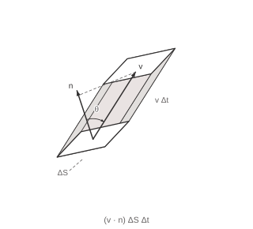
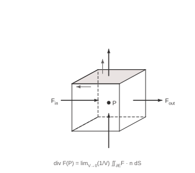
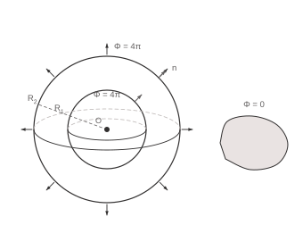

## Flow across a surface

A line integral measures the component of a field along a curve. A flux integral measures the component through a surface. The distinction is the difference between flow along a pipe and flow through its wall.

Consider a fluid with velocity field $\mathbf{v}(\mathbf{r}),$ and a small oriented patch of surface with unit normal $\mathbf{n}$ and area $\Delta S.$ In a short time $\Delta t,$ the fluid that crosses the patch fills a slanted cylinder whose base is the patch and whose axis is $\mathbf{v}\Delta t.$ The volume of that cylinder is

$$\Delta V=(\mathbf{v}\cdot\mathbf{n})\,\Delta S\,\Delta t \tag{1}$$

The dot product appears because only the component of velocity normal to the patch carries fluid through it. A velocity tangent to the patch moves fluid along the surface and crosses nothing. Dividing by $\Delta t$ gives the volume flow rate across the patch:

$$\frac{\Delta V}{\Delta t}=(\mathbf{v}\cdot\mathbf{n})\,\Delta S \tag{2}$$

Summing over a partition and passing to the limit gives the flux of $\mathbf{v}$ across $S,$

$$\iint_S\mathbf{v}\cdot\mathbf{n}\,dS \tag{3}$$

which is a volume per unit time. If the field is a mass flux $\rho\mathbf{v},$ the integral is a mass per unit time. If the field is an electric field, the integral is an electric flux; the same mathematics applies to heat flow, where $\mathbf{F}=-k\nabla T$ and the flux measures heat crossing the surface per unit time.

The sign is part of the definition. The normal $\mathbf{n}$ chooses a positive side of the surface, and the flux counts flow from the negative side to the positive side as positive. Reversing $\mathbf{n}$ reverses the sign of every contribution and therefore of the total.

## Definition

Let $S$ be an oriented piecewise smooth surface with unit normal $\mathbf{n},$ and let $\mathbf{F}$ be a continuous vector field on $S.$ The **flux integral** of $\mathbf{F}$ across $S$ is

$$\iint_S\mathbf{F}\cdot d\mathbf{S}=\iint_S\mathbf{F}\cdot\mathbf{n}\,dS \tag{4}$$

The notation $d\mathbf{S}=\mathbf{n}\,dS$ combines the unit normal and the area element. The integral is the same object as the vector surface integral of the previous entry; the name flux records its interpretation and the fact that the orientation is essential.

If $S$ is parameterized by $\mathbf{r}(u,v)$ over a region $D,$ and the orientation is the one determined by the order $(u,v),$ then

$$d\mathbf{S}=(\mathbf{r}_u\times\mathbf{r}_v)\,du\,dv \tag{5}$$

and

$$\iint_S\mathbf{F}\cdot d\mathbf{S}=\iint_D\mathbf{F}(\mathbf{r}(u,v))\cdot(\mathbf{r}_u\times\mathbf{r}_v)\,du\,dv \tag{6}$$

The cross product supplies both the normal direction and the area factor, so the unit normal never has to be computed separately. This is the most efficient formula in practice.

If the surface is a graph $z=g(x,y)$ with the upward orientation, then

$$d\mathbf{S}=\langle-g_x,\ -g_y,\ 1\rangle\,dx\,dy \tag{7}$$

and, for $\mathbf{F}=\langle P,Q,R\rangle,$

$$\iint_S\mathbf{F}\cdot d\mathbf{S}=\iint_D\bigl(-P\,g_x-Q\,g_y+R\bigr)\,dx\,dy \tag{8}$$

The downward orientation changes the sign of the integrand. Formula (8) is easy to misapply because the signs of $g_x$ and $g_y$ are easy to lose; deriving it from (7) at each use is safer than memorising it.

## A constant field through a disk

Let $S$ be the disk of radius $R$ in the plane $z=0,$ oriented upward, and let $\mathbf{F}=\langle0,0,c\rangle$ with $c>0.$ The unit normal is $\mathbf{k},$ so $\mathbf{F}\cdot\mathbf{n}=c$ and

$$\iint_S\mathbf{F}\cdot d\mathbf{S}=c\iint_S dS=c\pi R^2 \tag{9}$$

The flux is the field strength times the area. If the same disk is tilted so that its normal makes an angle $\theta$ with the vertical, the flux becomes $c\pi R^2\cos\theta,$ because the normal component is $c\cos\theta.$ If instead the disk is replaced by any graph over the same horizontal region, the upward flux of a constant vertical field is still $c$ times the projected area: the extra tilt increases both the area and the angle, and the two effects cancel in the dot product.

This cancellation is a useful check. For a constant vertical field, the flux through a graph depends only on the area of its shadow on the $xy$-plane, not on its height or shape. A vertical field passes through a tilted sheet exactly as much as through its horizontal projection.

## A radial field through a sphere

Let

$$\mathbf{F}(x,y,z)=\langle x,y,z\rangle \tag{10}$$

and let $S$ be the sphere of radius $R$ centred at the origin, oriented outward. On the sphere, $\mathbf{n}=\langle x,y,z\rangle/R,$ so

$$\mathbf{F}\cdot\mathbf{n}=\frac{x^2+y^2+z^2}{R}=\frac{R^2}{R}=R \tag{11}$$

and

$$\iint_S\mathbf{F}\cdot d\mathbf{S}=R\cdot4\pi R^2=4\pi R^3 \tag{12}$$

The same value follows from the divergence theorem: $\operatorname{div}\mathbf{F}=3,$ the enclosed volume is $4\pi R^3/3,$ and the product is $4\pi R^3.$ The flux grows with the volume because the field itself grows with distance; this is not a field whose flux is independent of the radius.

The field $\langle x,y,z\rangle$ points outward everywhere, so the flux is positive for the outward orientation. With the inward orientation it would be $-4\pi R^3.$ The sign is not a convention about the field; it records which side of the surface is called positive.

## An inverse-square field

The inverse-square field

$$\mathbf{F}(\mathbf{r})=\frac{\mathbf{r}}{r^3} \qquad r=\lVert\mathbf{r}\rVert \tag{13}$$

behaves differently. On the sphere of radius $R$ centred at the origin, $\mathbf{n}=\mathbf{r}/R$ and

$$\mathbf{F}\cdot\mathbf{n}=\frac{\mathbf{r}}{R^3}\cdot\frac{\mathbf{r}}{R}=\frac{R^2}{R^4}=\frac1{R^2} \tag{14}$$

so

$$\iint_S\mathbf{F}\cdot d\mathbf{S}=\frac1{R^2}\cdot4\pi R^2=4\pi \tag{15}$$

The flux is independent of $R.$ The field weakens as $1/R^2$ while the area grows as $R^2,$ and the two effects cancel exactly.

This is the flux of a point source at the origin, apart from a constant. The divergence of $\mathbf{F}$ is zero at every point away from the origin:

$$\operatorname{div}\mathbf{F}=\frac{\partial}{\partial x}\left(\frac{x}{r^3}\right)+\frac{\partial}{\partial y}\left(\frac{y}{r^3}\right)+\frac{\partial}{\partial z}\left(\frac{z}{r^3}\right)=0 \qquad r>0 \tag{16}$$

Yet the flux through a closed surface enclosing the origin is $4\pi,$ not zero. The divergence theorem does not apply to the region inside that surface, because the field is not defined at the origin. The source sits at the excluded point, and its strength is measured by the flux through any surface that encloses it.

If a closed surface does not enclose the origin, the field is smooth on and inside the surface, the divergence theorem applies, and the flux is zero. The contrast between $4\pi$ and $0$ is entirely a question of what the surface encloses.

## A cube and a cylinder

For $\mathbf{F}=\langle x,y,z\rangle$ and the unit cube $0\le x,y,z\le1$ with outward orientation, the divergence theorem gives

$$\iint_{\partial E}\mathbf{F}\cdot d\mathbf{S}=\iiint_E3\,dV=3 \tag{17}$$

A face-by-face check confirms the value. On the face $x=1,$ the outward normal is $\mathbf{i}$ and $\mathbf{F}\cdot\mathbf{n}=x=1,$ so the flux is $1;$ the faces $y=1$ and $z=1$ contribute $1$ each. On the three faces through the origin, the relevant component of $\mathbf{F}$ vanishes, so they contribute nothing. The total is $3.$

For the closed cylinder $x^2+y^2\le R^2,$ $0\le z\le h,$ with outward orientation, the side has normal $\langle x,y,0\rangle/R$ and $\mathbf{F}\cdot\mathbf{n}=R,$ so its flux is $2\pi Rh\cdot R=2\pi R^2h.$ The top has normal $\mathbf{k}$ and $\mathbf{F}\cdot\mathbf{n}=h,$ giving $\pi R^2h.$ The bottom has normal $-\mathbf{k}$ and $\mathbf{F}\cdot\mathbf{n}=-z=0.$ The total is

$$2\pi R^2h+\pi R^2h=3\pi R^2h \tag{18}$$

which is $3$ times the volume $\pi R^2h,$ in agreement with the divergence theorem.

## Closed surfaces and the divergence theorem

The examples illustrate the general result. Let $E$ be a compact solid with piecewise smooth boundary $\partial E,$ oriented outward, and let $\mathbf{F}$ be of class $C^1$ on an open set containing $E.$ Then

$$\iint_{\partial E}\mathbf{F}\cdot d\mathbf{S}=\iiint_E\operatorname{div}\mathbf{F}\,dV \tag{19}$$

The left side is the net flux out of $E;$ the right side adds the divergence over the interior. The theorem says that the net flow through the boundary is the sum of the local sources and sinks inside.

The divergence can therefore be read as a flux density:

$$\operatorname{div}\mathbf{F}(P)=\lim_{V\to0}\frac1{V}\iint_{\partial E}\mathbf{F}\cdot d\mathbf{S} \tag{20}$$

where $E$ is a small solid containing $P$ with volume $V.$ A positive divergence is a net source per unit volume; a negative divergence is a sink; zero divergence means that whatever enters a small region leaves it.

A field with zero divergence everywhere in a region is called solenoidal or incompressible. For such a field, the flux through every closed surface inside the region is zero. Equivalently, the flux through two open surfaces with the same boundary and consistent orientations is the same, because together they form a closed surface and the field is divergence-free in the enclosed volume. This is the flux analogue of path independence for a curl-free field.

## Flux through an open surface

The dependence on the surface is the subtle point for open surfaces. Let

$$\mathbf{F}(x,y,z)=\langle x,y,0\rangle \tag{21}$$

and let $S$ be the paraboloid $z=x^2+y^2$ with $0\le z\le1,$ oriented upward. Parameterize it by

$$\mathbf{r}(r,\theta)=\langle r\cos\theta,\ r\sin\theta,\ r^2\rangle \qquad 0\le r\le1,\quad 0\le\theta\le2\pi \tag{22}$$

Then

$$\mathbf{r}_r\times\mathbf{r}_\theta=\langle-2r^2\cos\theta,\ -2r^2\sin\theta,\ r\rangle \tag{23}$$

which points upward because its $z$-component is $r>0.$ Moreover,

$$\mathbf{F}(\mathbf{r}(r,\theta))=\langle r\cos\theta,\ r\sin\theta,\ 0\rangle \tag{24}$$

so

$$\mathbf{F}\cdot(\mathbf{r}_r\times\mathbf{r}_\theta)=-2r^3\cos^2\theta-2r^3\sin^2\theta=-2r^3 \tag{25}$$

and

$$\iint_S\mathbf{F}\cdot d\mathbf{S}=\int_0^{2\pi}\int_0^1(-2r^3)\,dr\,d\theta=-\pi \tag{26}$$

The flux is negative even though the field points radially outward. The reason is geometric: the upward normal on the paraboloid tilts inward, toward the axis, so an outward radial field crosses the surface from the positive side to the negative side. The sign is a property of the chosen orientation, not a contradiction.

The divergence theorem confirms the computation. The solid $E$ bounded by the paraboloid and the disk $z=1$ has volume

$$\iiint_E dV=\int_0^1\pi z\,dz=\frac{\pi}{2} \tag{27}$$

and $\operatorname{div}\mathbf{F}=2,$ so the outward flux is $\pi.$ The outward normal on the paraboloid is the negative of the upward normal, so the outward flux through the paraboloid is $-\iint_S\mathbf{F}\cdot d\mathbf{S}=\pi.$ The top disk has normal $\mathbf{k}$ and $\mathbf{F}\cdot\mathbf{k}=0,$ so it contributes nothing. The total is $\pi,$ as required.

The example also shows why the orientation must be recorded before the integral is evaluated. The same surface with the downward orientation has flux $+\pi.$ Neither value is wrong; they answer different questions.

## What flux integrals do not say

+ Flux is not field strength. A weak field spread over a large surface can have a larger flux than a strong field over a small one, and a strong field tangent to a surface has zero flux.
+ Zero flux does not imply zero field. A field can enter one part of a closed surface and leave another, or run tangent to an open surface, with zero net flux.
+ The sign depends on the orientation. For a closed surface the outward convention is standard; for an open surface both choices are legitimate, and the integral changes sign when the choice changes.
+ The divergence theorem requires a closed surface, an outward normal, and a field of class $C^1$ on the enclosed solid. A singularity inside the surface, as in the inverse-square field, invalidates the naive application.
+ The flux through an open surface generally depends on the surface, not only on its boundary. It is independent of the surface only when the field is divergence-free in the region between the two surfaces.
+ A flux integral does not compute the amount of field inside the surface. It computes the net flow through the boundary; the interior is reached only through the divergence theorem.

- - -

Flux integrals turn a vector field into a scalar measure of flow through a surface. The divergence theorem converts the boundary integral into a volume integral of the divergence, and the divergence measures the local source strength that the flux detects globally. The same pattern, one dimension lower, is the relation between circulation and curl.

## Related notions

The area element and orientation come from [parametric surfaces](../parametric-surfaces/), and the general integration theory is in [surface integrals](../surface-integrals/). The divergence theorem connects the flux to the [divergence](../divergence/), and the circulation analogue is the [curl](../curl/) with Stokes' theorem. The inverse-square field is the gradient of $1/r,$ so it is also a [conservative field](../conservative-vector-fields/) away from the origin. The flux of a velocity field is the surface analogue of the [line integral](../line-integrals/) of a field along a curve.
