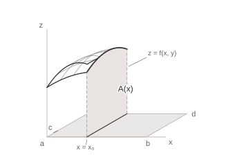
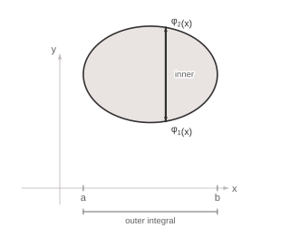
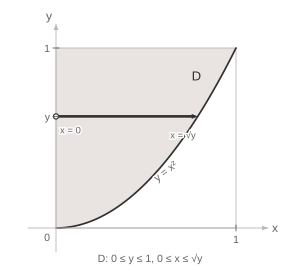

## Slicing an integral

A double integral is defined over a plane region, but its value is usually computed by two one-dimensional integrations. The first integration fixes one variable and integrates along a slice; the second integrates the resulting function of the remaining variable. Fubini's theorem states when this procedure is valid and when the two orders of integration give the same result.

The geometric idea is visible in the volume interpretation. Suppose $f\ge0$ on a rectangle $R=[a,b]\times[c,d]$. For each fixed $x$, the slice of the solid by the plane through $x$ perpendicular to the $x$-axis has area

$$A(x)=\int_c^d f(x,y)\,dy$$

and the volume is the integral of the slice areas:

$$V=\int_a^b A(x)\,dx \tag{1}$$

The question is whether this Cavalieri-style argument is legitimate for the functions that occur in practice, and whether the roles of $x$ and $y$ can be exchanged. Both answers are affirmative under mild hypotheses, but not without them.

## The theorem for rectangles

+ **Theorem (Fubini, rectangles).** Let $R=[a,b]\times[c,d]$ and let $f:R\to\mathbb{R}$ be integrable. Suppose that for every $x\in[a,b]$ the section $y\mapsto f(x,y)$ is integrable on $[c,d]$. Then the function

$$g(x)=\int_c^d f(x,y)\,dy$$

is integrable on $[a,b]$, and

$$\iint_R f(x,y)\,dA=\int_a^b g(x)\,dx=\int_a^b\left(\int_c^d f(x,y)\,dy\right)dx \tag{2}$$

If instead every horizontal section $x\mapsto f(x,y)$ is integrable on $[a,b]$, then the analogous formula holds with the order reversed:

$$\iint_R f(x,y)\,dA=\int_c^d\left(\int_a^b f(x,y)\,dx\right)dy \tag{3}$$

The theorem has two distinct conclusions. The first is that the slice integral $g$ is itself integrable, so that the outer integral exists. The second is that its integral equals the double integral. Neither conclusion is automatic from the existence of the inner integrals alone.

The hypothesis that the sections are integrable is satisfied automatically when $f$ is continuous on $R$. A continuous function on a compact rectangle is bounded and uniformly continuous, so each section is continuous, hence integrable. The same holds when $f$ is bounded and its discontinuities lie on finitely many smooth curves that meet each vertical and horizontal line in finitely many points. In that case the exceptional set has zero area and the sections are integrable except possibly at finitely many parameter values, which do not affect the outer integral.

A useful consequence is that for a continuous function on a rectangle both iterated integrals exist and are equal to the double integral. This is the form in which the theorem is usually applied. The more general statement above is needed when the integrand has jumps, as in the indicator functions used to integrate over non-rectangular regions.

## Why the theorem holds

The proof compares the slice integral with the step functions produced by a partition. It is short enough to give in full for the rectangle case.

Let $P$ be a partition of $R$ into subrectangles $I_i\times J_j$, where $I_i=[x_{i-1},x_i]$ and $J_j=[y_{j-1},y_j]$. Let

$$m_{ij}=\inf_{I_i\times J_j}f \qquad M_{ij}=\sup_{I_i\times J_j}f$$

For $x\in I_i$, define

$$L_P(x)=\sum_j m_{ij}\,|J_j| \qquad U_P(x)=\sum_j M_{ij}\,|J_j|$$

On each interval $I_i$ these are constants, so $L_P$ and $U_P$ are step functions on $[a,b]$. For every $x\in I_i$ and every $y\in J_j$,

$$m_{ij}\le f(x,y)\le M_{ij}$$

Integrating in $y$ over each $J_j$ and summing gives

$$L_P(x)\le\int_c^d f(x,y)\,dy\le U_P(x)$$

for every $x$ at which the section is integrable. Hence

$$L_P(x)\le g(x)\le U_P(x) \tag{4}$$

on a set of $x$ that includes every point of $[a,b]$ under the section hypothesis. Integrating (4) over $[a,b]$,

$$\int_a^b L_P(x)\,dx\le\int_a^b g(x)\,dx\le\int_a^b U_P(x)\,dx$$

The two outer integrals are exactly the lower and upper Darboux sums of $f$:

$$\int_a^b L_P(x)\,dx=L(f,P) \qquad \int_a^b U_P(x)\,dx=U(f,P) \tag{5}$$

Since $f$ is integrable, for every $\varepsilon>0$ there is a partition $P$ with $U(f,P)-L(f,P)<\varepsilon$. For such a partition, $g$ is squeezed between two step functions whose integrals differ by less than $\varepsilon$. A bounded function with this property is integrable, and its integral is the common limit of the two integrals. Therefore $g$ is integrable and

$$\int_a^b g(x)\,dx=\iint_R f\,dA$$

which proves (2). The proof of (3) is the same with the roles of $x$ and $y$ exchanged.

The argument also explains why the section hypothesis cannot be dropped from this proof. Equation (4) is asserted pointwise in $x$, and the integral of $g$ is taken over the whole interval. If a section fails to be integrable on a set of $x$ of positive length, the function $g$ is not defined there in the Riemann sense, and the comparison of step functions does not apply.

## Regions that are not rectangles

The theorem extends to a region $D$ contained in a rectangle $R$ by applying it to the extension $F=f\chi_D$. If $F$ is integrable on $R$ and its sections are integrable, then

$$\iint_D f\,dA=\int_a^b\left(\int_c^d F(x,y)\,dy\right)dx \tag{6}$$

For a type I region

$$D=\{(x,y):a\le x\le b,\ \varphi_1(x)\le y\le\varphi_2(x)\}$$

the section $F(x,\cdot)$ vanishes outside $[\varphi_1(x),\varphi_2(x)]$, so the inner integral is

$$\int_c^d F(x,y)\,dy=\int_{\varphi_1(x)}^{\varphi_2(x)}f(x,y)\,dy$$

and (6) becomes

$$\iint_D f\,dA=\int_a^b\left(\int_{\varphi_1(x)}^{\varphi_2(x)}f(x,y)\,dy\right)dx \tag{7}$$

For a type II region the inner integral is in $x$ and the outer limits are functions of $y$. This is the form used in the entry on [double integrals](../double-integrals/); Fubini's theorem is what justifies it.

The same reduction applies in three dimensions. For a $z$-simple solid

$$D=\{(x,y,z):(x,y)\in\Omega,\ \psi_1(x,y)\le z\le\psi_2(x,y)\}$$

applying Fubini twice gives

$$\iiint_D f\,dV=\iint_\Omega\left(\int_{\psi_1(x,y)}^{\psi_2(x,y)}f(x,y,z)\,dz\right)dA \tag{8}$$

and the remaining double integral is evaluated in either order. The entry on [triple integrals](../triple-integrals/) develops this reduction; it is the same theorem applied successively to the three variables.

## Changing the order of integration

When the hypotheses of Fubini's theorem hold, the order of integration may be changed. The procedure is mechanical but requires the region to be redrawn, not merely the limits swapped.

+ Sketch $D$ and write its inequalities in the current order.
+ Rewrite the same set with the variables exchanged: identify the range of the new outer variable and, for each value, the interval of the new inner variable.
+ Check that the new description covers exactly $D$, including the boundary.
+ Integrate. The value must agree with the original integral if both are covered by the theorem.

As an example, consider

$$I=\iint_D x e^{y^2}\,dA \qquad D=\{(x,y):0\le x\le1,\ x^2\le y\le1\}$$

Integrating first in $y$ is not feasible, because $e^{y^2}$ has no elementary antiderivative. The region is also described by $0\le y\le1$ and $0\le x\le\sqrt y$. Hence

$$I=\int_0^1\left(\int_0^{\sqrt y}xe^{y^2}\,dx\right)dy=\int_0^1\frac{y}{2}e^{y^2}\,dy=\frac{e-1}{4}$$

The inner integral produced the factor $y/2$, and the substitution $u=y^2$ then gives the value. The integrand is continuous on the closed region, so Fubini's theorem applies in either order and the computed value is the double integral.

A second example shows that a poor choice of order can be merely inefficient rather than impossible. On $R=[0,1]^2$,

$$\iint_R x\cos(xy)\,dA=\int_0^1\left(\int_0^1x\cos(xy)\,dy\right)dx=\int_0^1\sin x\,dx=1-\cos1$$

The inner integration in $y$ is immediate because $x$ is constant. The reverse order requires integration by parts in $x$ and gives the same value, but with more work. Fubini's theorem guarantees equality, not equal difficulty.

## When the hypotheses fail

The integrability of $f$ is essential, and the integrability of the sections is essential for the Riemann formulation. Without them, the iterated integrals may exist and disagree.

The standard example is

$$f(x,y)=\frac{x^2-y^2}{(x^2+y^2)^2}$$

on the unit square $[0,1]^2$. For fixed $y$,

$$\int_0^1\frac{x^2-y^2}{(x^2+y^2)^2}\,dx=\left[-\frac{x}{x^2+y^2}\right]_{x=0}^{x=1}=-\frac{1}{1+y^2}$$

so one iterated integral is

$$\int_0^1\left(-\frac{1}{1+y^2}\right)dy=-\frac{\pi}{4}$$

For fixed $x$, the roles reverse:

$$\int_0^1\frac{x^2-y^2}{(x^2+y^2)^2}\,dy=\left[\frac{y}{x^2+y^2}\right]_{y=0}^{y=1}=\frac{1}{1+x^2}$$

and the other iterated integral is

$$\int_0^1\frac{1}{1+x^2}\,dx=\frac{\pi}{4}$$

The two values differ, so no theorem can equate them. The function is unbounded near the origin: along the line $y=x$ the numerator vanishes, but along $y=0$ it equals $1/x^2$. It is not Riemann integrable on the square, and it is not Lebesgue integrable either, because $|f|$ behaves like $r^{-2}$ near the origin and $\int_0^1 r^{-2}\,r\,dr$ diverges. The hypothesis of Fubini's theorem fails at the first step.

Existence of both iterated integrals is therefore not enough. In the Lebesgue theory, the correct replacement is the Fubini–Tonelli theorem.

+ **Tonelli.** Let $(X,\mathcal{A},\mu)$ and $(Y,\mathcal{B},\nu)$ be $\sigma$-finite measure spaces and let $f:X\times Y\to[0,\infty]$ be measurable and nonnegative. Then the functions $x\mapsto\int f(x,y)\,d\nu(y)$ and $y\mapsto\int f(x,y)\,d\mu(x)$ are measurable, and

$$\int_{X\times Y}f\,d(\mu\times\nu)=\int_X\left(\int_Y f\,d\nu\right)d\mu=\int_Y\left(\int_X f\,d\mu\right)d\nu \tag{9}$$

with all three quantities allowed to be $+\infty$.

+ **Fubini.** If $f$ is integrable with respect to the product measure, meaning $\int|f|\,d(\mu\times\nu)<\infty$, then $f$ is finite almost everywhere, the sections are integrable for almost every value of the other variable, and the two iterated integrals exist and equal the product integral.

Tonelli requires no finiteness assumption because nonnegative extended integrals always exist. Fubini then handles signed functions by applying Tonelli to $|f|$ first. In the example above, $\int|f|$ is infinite, so neither theorem applies.

The measure-theoretic statement also explains the role of $\sigma$-finiteness. Rectangles, balls, and the usual domains of integration are $\sigma$-finite, so the condition is invisible in elementary applications. It matters for pathological measure spaces, where the iterated integrals can behave differently.

## Relation to the other integral notions

Fubini's theorem is the bridge between the definition of a multiple integral and its computation. In two dimensions it justifies the iterated formulas for [double integrals](../double-integrals/); in three dimensions it justifies the reduction of [triple integrals](../triple-integrals/) to one-dimensional integrations. The change-of-variables formula in [cylindrical coordinates](../cylindrical-coordinates/) and [spherical coordinates](../spherical-coordinates/) is a separate theorem, but the resulting integrals are almost always evaluated by Fubini's theorem after the coordinate change.

The theorem is also the precise statement behind the informal rule that a double sum can be summed in either order. For finite sums the rule is trivial. For integrals it requires integrability, and the counterexample above shows that the requirement is not a technicality.
