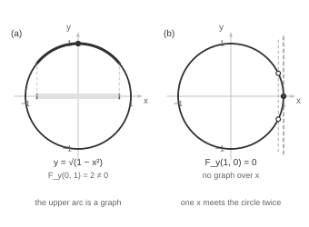
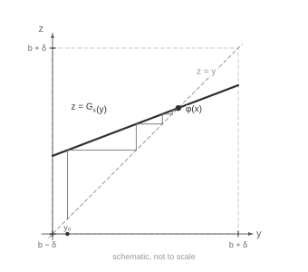

## The problem

An equation $F(x,y)=0$ may define $y$ as a function of $x$ without giving that function explicitly. The circle

$$x^2+y^2=1$$

does not express $y$ in terms of $x$ by a single formula, but near the point $(0,1)$ the upper arc is the graph of $y=\sqrt{1-x^2}$. Near $(1,0)$ the same circle is not a graph over the $x$-axis: the tangent is vertical, and a small change of $x$ below $1$ produces two values of $y$.

The implicit function theorem gives a condition that decides when such a local solution exists, is unique, and is as differentiable as the equation. The condition is stated in terms of the derivative with respect to the variables that are to be solved for. In the circle example, solving for $y$ requires the derivative with respect to $y$ to be nonzero, and that derivative is $2y$, which vanishes at $(1,0)$ but not at $(0,1)$.

The theorem is local. It describes the solution near a known point $(a,b)$ with $F(a,b)=0$; it does not produce a formula for the solution and it does not describe the solution far from that point.

## The scalar case

Let $U\subseteq\mathbb{R}^2$ be open and let $F:U\to\mathbb{R}$ be of class $C^1$. Suppose that $F(a,b)=0$ and

$$F_y(a,b)\neq0$$

Then there are an open interval $I$ containing $a$, an open interval $J$ containing $b$, and a unique function $\varphi:I\to J$ of class $C^1$ such that

$$\varphi(a)=b \qquad\text{and}\qquad F(x,\varphi(x))=0 \quad\text{for every }x\in I \tag{1}$$

Moreover,

$$\varphi'(x)=-\frac{F_x(x,\varphi(x))}{F_y(x,\varphi(x))} \tag{2}$$

for every $x\in I$. The formula is obtained by differentiating (1) with respect to $x$ and solving for $\varphi'$; the denominator is nonzero near $a$ because $F_y(a,b)\neq0$ and $F_y$ is continuous.

The condition is sufficient, not necessary. The equation $x^2-y^3=0$ near $(0,0)$ has $F_y(0,0)=0$, yet it defines the unique continuous function $y=x^{2/3}$. That function is not differentiable at the origin, so the conclusion of the theorem fails even though a solution exists. The theorem guarantees a differentiable solution only when the derivative with respect to the solved variable is nonzero.

The choice of variable matters. For $F(x,y)=x^2+y^2-1$ at $(1,0)$, $F_y=0$ and the equation cannot be solved for $y$ as a $C^1$ function of $x$ near $1$. But $F_x=2\neq0$, so the same equation can be solved for $x$ as a $C^1$ function of $y$ near $0$, namely $x=\sqrt{1-y^2}$.

## The general statement

Let $U\subseteq\mathbb{R}^{n+m}$ be open and let

$$F=(F_1,\ldots,F_m):U\to\mathbb{R}^m$$

be of class $C^k$ with $k\ge1$. Write a point of $U$ as $(x,y)$, where $x\in\mathbb{R}^n$ and $y\in\mathbb{R}^m$. Let $(a,b)\in U$ satisfy

$$F(a,b)=0$$

and suppose that the $m\times m$ matrix

$$D_yF(a,b)=\left(\frac{\partial F_i}{\partial y_j}(a,b)\right)_{i,j=1}^{m}$$

is invertible. Then there exist an open neighbourhood $V$ of $a$ in $\mathbb{R}^n$, an open neighbourhood $W$ of $b$ in $\mathbb{R}^m$, and a unique map $\varphi:V\to W$ of class $C^k$ such that

$$\varphi(a)=b \qquad\text{and}\qquad F(x,\varphi(x))=0 \quad\text{for every }x\in V \tag{3}$$

Moreover, the zero set of $F$ near $(a,b)$ is exactly the graph of $\varphi$:

$$\{(x,y)\in V\times W:F(x,y)=0\}=\{(x,\varphi(x)):x\in V\} \tag{4}$$

The derivative of $\varphi$ at $a$ is

$$D\varphi(a)=-\bigl[D_yF(a,b)\bigr]^{-1}D_xF(a,b) \tag{5}$$

where $D_xF(a,b)$ is the $m\times n$ matrix of derivatives with respect to $x_1,\ldots,x_n$.

In the scalar case $n=m=1$, equation (5) reduces to (2). The inverse of the $1\times1$ matrix $D_yF(a,b)$ is $1/F_y(a,b)$, and the sign is the minus sign in (2).

The theorem solves $m$ equations for $m$ of the $n+m$ variables. The remaining $n$ variables are the parameters. The hypothesis is that the equations are genuinely coupled to the solved variables at the point: the linearisation in those variables must be invertible.

## Linearisation

The hypothesis has a simple linear interpretation. The first-order expansion of $F$ at $(a,b)$ is

$$F(a+h,b+k)=D_xF(a,b)h+D_yF(a,b)k+o\bigl(\lVert(h,k)\rVert\bigr) \tag{6}$$

where $h\in\mathbb{R}^n$ and $k\in\mathbb{R}^m$. The linear equation $D_xF\,h+D_yF\,k=0$ has the unique solution

$$k=-\bigl[D_yF(a,b)\bigr]^{-1}D_xF(a,b)h$$

for every $h$, precisely because $D_yF(a,b)$ is invertible. The theorem says that, for small $h$, the nonlinear equation inherits this unique solution, with $k$ depending differentiably on $h$. The derivative of the solution at $a$ is the solution of the linearised equation, which is (5).

This is the same principle as the [inverse function theorem](../inverse-function-theorem/): an invertible derivative allows a nonlinear map to be inverted locally. The two theorems are equivalent, and either can be deduced from the other.

## The contraction proof

The existence and uniqueness of $\varphi$ can be proved by the contraction mapping principle. Differentiability is then obtained from the linearisation.

First reduce to the case $D_yF(a,b)=I$. Let $A=D_yF(a,b)$ and replace $F$ by $A^{-1}F$. The new map has the same zero set, and its derivative with respect to $y$ at $(a,b)$ is $A^{-1}A=I$. Its derivative with respect to $x$ is $A^{-1}D_xF(a,b)$, where $F$ on the right denotes the original map. Hence the formula proved for the normalised map is already (5) when written in terms of the original $F$.

Choose $\delta>0$ and $\rho>0$ such that the product

$$\overline{B}(a,\rho)\times\overline{B}(b,2\delta)$$

is contained in $U$, and such that

$$\lVert D_yF(x,y)-I\rVert\le\frac12 \qquad\text{and}\qquad \lVert F(x,b)\rVert\le\frac{\delta}{4}$$

for $\lVert x-a\rVert\le\rho$ and $\lVert y-b\rVert\le2\delta$. This is possible because $D_yF$ is continuous and $D_yF(a,b)=I$, and because $F(a,b)=0$ and $F$ is continuous.

For fixed $x$ with $\lVert x-a\rVert\le\rho$, define

$$G_x(y)=y-F(x,y) \qquad \lVert y-b\rVert\le\delta$$

A fixed point $G_x(y)=y$ is exactly a solution of $F(x,y)=0$.

The map $G_x$ sends the closed ball $\overline{B}(b,\delta)$ into itself. Indeed,

$$G_x(y)-b=-F(x,b)+\bigl[(y-b)-(F(x,y)-F(x,b))\bigr]$$

and the bracket can be written as

$$\int_0^1\bigl(I-D_yF(x,b+t(y-b))\bigr)(y-b)\,dt$$

so its norm is at most $\frac12\lVert y-b\rVert$. Hence

$$\lVert G_x(y)-b\rVert\le\frac{\delta}{4}+\frac{\delta}{2}=\frac{3\delta}{4}<\delta$$

For $y_1,y_2$ in the ball, the same integral representation applied to the difference gives

$$\lVert G_x(y_1)-G_x(y_2)\rVert\le\frac12\lVert y_1-y_2\rVert$$

so $G_x$ is a contraction. The contraction mapping principle, stated below, gives a unique fixed point $\varphi(x)\in\overline{B}(b,\delta)$, and therefore a unique solution of $F(x,\varphi(x))=0$ in that ball.

+ **Contraction mapping principle.** Let $X$ be a complete metric space and let $T:X\to X$ satisfy $d(Tu,Tv)\le q\,d(u,v)$ for some $q<1$ and all $u,v\in X$. Then $T$ has a unique fixed point.

To see this, start from any $u_0\in X$ and define $u_{k+1}=Tu_k$. The estimate

$$d(u_{k+1},u_k)\le q^{k}d(u_1,u_0)$$

shows that $(u_k)$ is a Cauchy sequence; completeness gives a limit $u$. Continuity of $T$ gives $Tu=u$. If $u$ and $v$ are fixed points, then $d(u,v)\le q\,d(u,v)$, hence $u=v$.

The function $\varphi$ is continuous. For $x,x'$ near $a$,

$$\varphi(x)-\varphi(x')=\bigl[G_x(\varphi(x))-G_x(\varphi(x'))\bigr]+\bigl[G_x(\varphi(x'))-G_{x'}(\varphi(x'))\bigr]$$

The first bracket has norm at most $\frac12\lVert\varphi(x)-\varphi(x')\rVert$. The second equals $F(x',\varphi(x'))-F(x,\varphi(x'))$. On the compact product $\overline{B}(a,\rho)\times\overline{B}(b,\delta)$, the function $F$ is uniformly continuous, so this difference tends to $0$ as $x'\to x$, uniformly in the second argument. Therefore

$$\lVert\varphi(x)-\varphi(x')\rVert\le2\lVert F(x',\varphi(x'))-F(x,\varphi(x'))\rVert\to0$$

so $\varphi$ is continuous.

For differentiability, let $k=\varphi(x+h)-\varphi(x)$. Since both points solve the equation,

$$0=F(x+h,\varphi(x+h))-F(x,\varphi(x))$$

Expanding at $(x,\varphi(x))$ gives

$$0=D_xF(x,\varphi(x))h+D_yF(x,\varphi(x))k+o\bigl(\lVert h\rVert+\lVert k\rVert\bigr)$$

Near $(a,b)$, $D_yF$ is invertible; write $Q(x)=[D_yF(x,\varphi(x))]^{-1}$. Then

$$k=-Q(x)D_xF(x,\varphi(x))h+o\bigl(\lVert h\rVert+\lVert k\rVert\bigr)$$

The coefficient is bounded near $a$, so this estimate first gives $\lVert k\rVert=O(\lVert h\rVert)$. The little-o term is therefore $o(\lVert h\rVert)$. Letting $h\to0$ gives

$$D\varphi(a)=-Q(a)D_xF(a,b)$$

For the normalised map, $Q(a)=I$ and $D_xF(a,b)=A^{-1}D_xF_{\mathrm{original}}(a,b)$. Substituting these expressions gives (5).

If $F$ is of class $C^k$ with $k\ge2$, then $\varphi$ is $C^1$ and (5) expresses $D\varphi$ as a composition of $C^{k-1}$ maps and the smooth operation of matrix inversion. Hence $D\varphi$ is $C^{k-1}$, so $\varphi$ is $C^k$. Induction gives the stated regularity.

## A circle

Return to

$$F(x,y)=x^2+y^2-1$$

At $(a,b)=(0,1)$, $F(0,1)=0$ and

$$F_y(0,1)=2\neq0$$

The theorem gives a $C^1$ function $\varphi$ near $0$ with $\varphi(0)=1$ and $F(x,\varphi(x))=0$. In this case the function is explicit:

$$\varphi(x)=\sqrt{1-x^2} \qquad |x|<1$$

and

$$\varphi'(x)=-\frac{x}{\sqrt{1-x^2}}=-\frac{F_x}{F_y}$$

At $x=0$, $\varphi'(0)=0$, in agreement with the formula.

At $(1,0)$, the hypothesis fails because $F_y(1,0)=0$. The circle has a vertical tangent there, and $y$ is not a $C^1$ function of $x$ near $1$. The equation can still be solved for $x$ as a function of $y$, because $F_x(1,0)=2\neq0$.

## An equation without a closed form

Consider

$$F(x,y)=y^3+y+x$$

At $(0,0)$, $F(0,0)=0$ and $F_y(0,0)=1\neq0$. The theorem guarantees a unique $C^1$ function $\varphi$ near $0$ with $\varphi(0)=0$ and

$$\varphi(x)^3+\varphi(x)+x=0$$

There is a real cubic formula for $\varphi$, but it is not needed. Differentiating the identity gives

$$3\varphi(x)^2\varphi'(x)+\varphi'(x)+1=0$$

so

$$\varphi'(x)=-\frac{1}{3\varphi(x)^2+1}$$

At $x=0$, $\varphi'(0)=-1$. The example shows that the theorem is useful even when the solution cannot be written in a simple form.

## A system of two equations

Consider

$$F_1(x,y,u,v)=u+v-x \qquad F_2(x,y,u,v)=uv-y$$

near $(x,y,u,v)=(3,2,2,1)$. Both equations vanish at this point. The variables to be solved for are $(u,v)$, so

$$D_{(u,v)}F=\begin{pmatrix}1&1\\ v&u\end{pmatrix}=\begin{pmatrix}1&1\\ 1&2\end{pmatrix}$$

whose determinant is $1$. The hypothesis holds, so $(u,v)$ is a $C^1$ function of $(x,y)$ near $(3,2)$, with $(u(3,2),v(3,2))=(2,1)$.

The derivative is given by (5). Since

$$D_xF=\begin{pmatrix}-1&0\\ 0&-1\end{pmatrix}=-I$$

and

$$\bigl[D_{(u,v)}F\bigr]^{-1}=\begin{pmatrix}2&-1\\ -1&1\end{pmatrix}$$

we obtain

$$D\varphi(3,2)=\begin{pmatrix}2&-1\\ -1&1\end{pmatrix}$$

Thus

$$u_x=2 \qquad u_y=-1 \qquad v_x=-1 \qquad v_y=1$$

The result can be checked by implicit differentiation. Differentiating $u+v=x$ and $uv=y$ with respect to $x$ gives

$$u_x+v_x=1 \qquad vu_x+uv_x=0$$

Solving at $(u,v)=(2,1)$ gives $u_x=2$ and $v_x=-1$. Differentiating with respect to $y$ gives

$$u_y+v_y=0 \qquad vu_y+uv_y=1$$

which gives $u_y=-1$ and $v_y=1$.

## Level surfaces

A graph is a special case of an implicit equation. If $h:\mathbb{R}^2\to\mathbb{R}$ is $C^1$, the graph $z=h(x,y)$ can be written as

$$F(x,y,z)=z-h(x,y)=0$$

At any point, $F_z=1\neq0$, so the theorem applies with $m=1$ and solved variable $z$. The solution is $\varphi=h$, and (5) gives

$$\left(\frac{\partial z}{\partial x},\frac{\partial z}{\partial y}\right)=-(1)^{-1}\left(-h_x,-h_y\right)=(h_x,h_y)$$

which is the familiar derivative of a graph.

More generally, let $F:U\subseteq\mathbb{R}^{n+m}\to\mathbb{R}^m$ be $C^1$ and suppose that $F(p)=0$ and $\operatorname{rank}DF(p)=m$. Then $p$ is a regular point of $F$, and the level set $F^{-1}(0)$ is locally a smooth submanifold of dimension $n$. The theorem makes it a graph over some $n$-dimensional coordinate plane, and the tangent space at $p$ is the kernel of $DF(p)$:

$$T_pF^{-1}(0)=\ker DF(p) \tag{7}$$

For $m=1$, this says that $\nabla F(p)$ is normal to the level surface $F=0$. That fact is used in the entry on [Lagrange multipliers](../lagrange-multipliers/) and in the tangent-plane formula for level surfaces.

## When the hypothesis fails

The hypothesis $D_yF(a,b)$ invertible is sufficient, not necessary. Three failures illustrate what can happen.

+ **An isolated zero.** For $F(x,y)=x^2+y^2$ at $(0,0)$, $F_y(0,0)=0$. The zero set is the single point $(0,0)$, so there is no function $y=\varphi(x)$ on any interval around $0$: for $x\neq0$ the equation has no real solution.
+ **A crossing.** For $F(x,y)=x^2-y^2$ at $(0,0)$, $F_y(0,0)=0$. The zero set is the pair of lines $y=x$ and $y=-x$, which cross at the origin. Near the origin there are four branches, and no single function describes all of them.
+ **A cusp.** For $F(x,y)=x^2-y^3$ at $(0,0)$, $F_y(0,0)=0$. The zero set is the curve $y=x^{2/3}$, which is continuous and unique but has a vertical tangent at the origin. The theorem does not apply, and indeed the solution is not differentiable there.

In each case the derivative with respect to $y$ vanishes, and the linearisation does not determine $y$ as a function of $x$. The nonlinear equation may still have a solution, but its regularity or uniqueness is not controlled by the linear term.

## Scope and limitations

The theorem is local: it gives a neighbourhood of $a$ and a neighbourhood of $b$, with no estimate of their size. It gives no formula for $\varphi$, only its existence, uniqueness and derivative. The derivative formula is valid at points where $D_yF$ remains invertible, but the theorem does not assert that this persists beyond a neighbourhood of $a$.

The condition on $D_yF$ depends on the choice of dependent variables. A point at which $D_yF$ is singular may still allow a different choice of solved variables; the circle at $(1,0)$ is an example. A point at which the full derivative $DF$ has rank less than $m$ is a singular point of the level set, and no choice of $m$ dependent variables makes the theorem applicable.

The theorem is the local inverse-function statement in implicit form. It is used to justify the tangent space of a regular level set, the method of Lagrange multipliers, the change-of-variables formula and the local existence of solutions of systems of nonlinear equations. Each of these uses only the local graph and the derivative formula, not an explicit solution.
