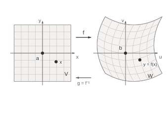
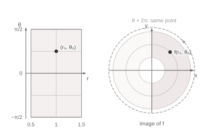

## Local inversion

A function $f:U\to V$ between open subsets of $\mathbb{R}^n$ is invertible if it is bijective, so that an inverse $f^{-1}:V\to U$ exists. For functions of one variable, a continuous injective function on an interval has a continuous inverse, and differentiability of the inverse is a separate question. In several variables the geometry is richer: a map can fold the plane, identify different points, or collapse a direction, and a global inverse may fail even when the map looks regular at every point.

The inverse function theorem is a local statement. It gives a condition under which a neighbourhood of a point can be mapped bijectively onto a neighbourhood of the image, with a differentiable inverse. The condition is that the derivative at the point is an invertible linear map.

Let $f:U\subseteq\mathbb{R}^n\to\mathbb{R}^n$ be of class $C^k$ with $k\ge1$, let $a\in U$, and put $b=f(a)$. The derivative $Df(a)$ is the $n\times n$ Jacobian matrix

$$Df(a)=\left(\frac{\partial f_i}{\partial x_j}(a)\right)_{i,j=1}^{n}$$

Its determinant is the Jacobian determinant $J_f(a)=\det Df(a)$.

## The theorem

+ **Inverse function theorem.** Let $U\subseteq\mathbb{R}^n$ be open and let $f:U\to\mathbb{R}^n$ be of class $C^k$ with $k\ge1$. Suppose that $a\in U$ and that $Df(a)$ is invertible. Put $b=f(a)$. Then there exist open sets $V\subseteq U$ containing $a$ and $W\subseteq\mathbb{R}^n$ containing $b$ such that $f$ maps $V$ bijectively onto $W$, the inverse $g=f^{-1}:W\to V$ is of class $C^k$, and for every $y\in W$, with $x=g(y)$,

$$Dg(y)=\bigl[Df(x)\bigr]^{-1} \tag{1}$$

In particular,

$$Dg(b)=\bigl[Df(a)\bigr]^{-1} \tag{2}$$

The theorem is local in two senses. The neighbourhoods $V$ and $W$ need not be large, and the inverse is constructed only on $W=f(V)$. The map $f$ may fail to be injective on all of $U$, and its image need not be all of $\mathbb{R}^n$; the theorem only asserts that $f(V)$ is open for the small $V$ it produces.

The condition is sufficient, not necessary. The map $f(x)=x^3$ from $\mathbb{R}$ to $\mathbb{R}$ is bijective with continuous inverse $g(y)=y^{1/3}$, but $f'(0)=0$. The inverse exists and is continuous, yet it is not differentiable at $0$. The theorem does not apply at $0$, and its differentiability conclusion indeed fails there.

## The linear case

For a linear map $f(x)=Ax+b$, with $A$ an $n\times n$ matrix, the derivative is $A$ at every point. The map is invertible on $\mathbb{R}^n$ exactly when $A$ is invertible, and the inverse is

$$f^{-1}(y)=A^{-1}(y-b)$$

with derivative $A^{-1}$.

The inverse function theorem says that a nonlinear map with invertible derivative at $a$ behaves, near $a$, like its linearisation. The linearisation is

$$f(a+h)=b+Df(a)h+o(\lVert h\rVert) \tag{3}$$

If $Df(a)$ is invertible, the linear equation $k=Df(a)h$ can be solved uniquely for $h$ as $h=[Df(a)]^{-1}k$. The theorem transfers this solvability to the nonlinear equation $f(x)=y$ for $y$ near $b$. The derivative of the inverse is the inverse of the derivative, exactly as in the linear case.

The determinant gives a practical test: $Df(a)$ is invertible if and only if $J_f(a)\neq0$. A nonzero Jacobian determinant at a point therefore guarantees a local $C^k$ inverse near that point.

## Proof from the implicit function theorem

The inverse function theorem follows from the [implicit function theorem](../implicit-function-theorem/). Define

$$F:U\times\mathbb{R}^n\to\mathbb{R}^n \qquad F(x,y)=f(x)-y$$

Then $F(a,b)=0$, and the derivative with respect to $x$ is

$$D_xF(a,b)=Df(a)$$

which is invertible by hypothesis. The implicit function theorem, applied with $y$ as the parameter and $x$ as the solved variable, gives open sets $W$ containing $b$ and $V$ containing $a$, and a unique $C^k$ map $\varphi:W\to V$ such that

$$\varphi(b)=a \qquad\text{and}\qquad F(\varphi(y),y)=0 \quad\text{for every }y\in W$$

The second identity is $f(\varphi(y))=y$. Hence $\varphi$ is a right inverse of $f$ on $W$. Replace $V$ by $V\cap f^{-1}(W)$ if necessary. This set is open because $f$ is continuous, it contains $a$ because $f(a)=b\in W$, and it satisfies $f(V)\subseteq W$. Moreover, for $y\in W$, the point $\varphi(y)$ lies in $V$, since $\varphi(y)\in V$ before the replacement and $f(\varphi(y))=y\in W$. Thus $f(V)=W$. Finally, for $x\in V$ with $f(x)=y$, we have $y\in W$ and $F(x,y)=0$, so uniqueness in the implicit function theorem gives $x=\varphi(y)$. Therefore $f$ maps $V$ bijectively onto $W$, and $g=\varphi$ is the inverse.

Differentiating $f(g(y))=y$ with respect to $y$ gives

$$Df(g(y))Dg(y)=I \tag{4}$$

Since $Df(g(y))$ is a square matrix, this identity shows that it is invertible and that

$$Dg(y)=\bigl[Df(g(y))\bigr]^{-1}$$

which is (1). Setting $y=b$ and $g(b)=a$ gives (2).

The same conclusion can be obtained directly from the contraction mapping principle. Put $A=Df(a)$ and define

$$T_y(x)=x+A^{-1}(y-f(x))$$

A fixed point $T_y(x)=x$ is exactly a solution of $f(x)=y$. Since

$$DT_y(x)=I-A^{-1}Df(x)=A^{-1}(A-Df(x))$$

the derivative has norm at most $\frac12$ in a small ball around $a$, so $T_y$ is a contraction there. For $y$ close to $b$, $T_y$ maps the ball into itself, and the contraction principle gives a unique fixed point. The derivative is then obtained from the same linearisation as above. This is the same contraction argument used in the entry on the implicit function theorem, applied to $F(x,y)=f(x)-y$ in the opposite direction.

## The one-dimensional case

For $n=1$, the theorem says that if $f$ is $C^k$ near $a$ and $f'(a)\neq0$, then $f$ has a local $C^k$ inverse $g$ near $b=f(a)$, with

$$g'(b)=\frac{1}{f'(a)} \tag{5}$$

This is the one-variable inverse function rule. The entry on the [derivative of the inverse function](../derivative-of-the-inverse-function/) proves the formula directly by the chain rule and the difference quotient.

For $f(x)=x^2$ at $a=1$, $f'(1)=2$ and $b=1$. The local inverse is $g(y)=\sqrt{y}$ near $1$, and $g'(1)=\frac12$. At $a=0$, $f'(0)=0$ and $f$ is not injective near $0$, so no local inverse exists.

For $f(x)=x^3$ at $a=0$, $f'(0)=0$ but $f$ is globally injective, with inverse $g(y)=y^{1/3}$. The inverse is continuous but not differentiable at $0$, so the conclusion of the theorem fails while a continuous inverse still exists. This is the standard example showing that invertibility of the derivative is sufficient but not necessary for invertibility itself.

## A linear example

Let

$$f(x,y)=(x+y,x-y)$$

The derivative is constant:

$$Df=\begin{pmatrix}1&1\\ 1&-1\end{pmatrix} \qquad \det Df=-2\neq0$$

The map is invertible on all of $\mathbb{R}^2$. Solving $u=x+y$ and $v=x-y$ gives

$$x=\frac{u+v}{2} \qquad y=\frac{u-v}{2}$$

so

$$g(u,v)=\left(\frac{u+v}{2},\frac{u-v}{2}\right)$$

and

$$Dg=\frac12\begin{pmatrix}1&1\\ 1&-1\end{pmatrix}$$

The product

$$Dg\,Df=\frac12\begin{pmatrix}1&1\\ 1&-1\end{pmatrix}\begin{pmatrix}1&1\\ 1&-1\end{pmatrix}=\begin{pmatrix}1&0\\ 0&1\end{pmatrix}$$

confirms (1). For a linear map the local inverse is global, and the theorem adds nothing beyond linear algebra; the example fixes the meaning of the formula.

## Polar coordinates

The map

$$f(r,\theta)=(r\cos\theta,r\sin\theta)$$

sends the half-plane $r>0$ to $\mathbb{R}^2\setminus\{(0,0)\}$. Its derivative is

$$Df(r,\theta)=\begin{pmatrix}\cos\theta&-r\sin\theta\\ \sin\theta&r\cos\theta\end{pmatrix}$$

and

$$\det Df(r,\theta)=r\cos^2\theta+r\sin^2\theta=r$$

For $r>0$ the determinant is nonzero, so the theorem gives a local $C^1$ inverse near every point of the half-plane. The inverse is the usual map

$$(x,y)\mapsto\left(\sqrt{x^2+y^2},\theta(x,y)\right)$$

where $\theta$ is a continuous branch of the polar angle.

The map is not globally injective, because $(r,\theta+2\pi)$ has the same image as $(r,\theta)$. The theorem is local and does not contradict this: near each point one chooses an angular interval of length less than $2\pi$, and on that interval the map is injective.

The derivative of the inverse can be read from (1). Since

$$\bigl[Df(r,\theta)\bigr]^{-1}=\begin{pmatrix}\cos\theta&\sin\theta\\[4pt] -\dfrac{\sin\theta}{r}&\dfrac{\cos\theta}{r}\end{pmatrix}$$

the partial derivatives of $r$ and $\theta$ with respect to $x$ and $y$ are the entries of this matrix, evaluated at the point. For example, $\partial r/\partial x=\cos\theta=x/r$ and $\partial\theta/\partial x=-\sin\theta/r=-y/(x^2+y^2)$.

## A map that is locally but not globally invertible

Let

$$f(x,y)=(x^2-y^2,2xy)$$

This is the square of the complex number $x+iy$, written in real coordinates. Its derivative is

$$Df(x,y)=\begin{pmatrix}2x&-2y\\ 2y&2x\end{pmatrix}$$

and

$$\det Df(x,y)=4x^2+4y^2$$

The determinant is nonzero at every point except the origin. Hence $f$ has a local $C^1$ inverse near every point other than $(0,0)$.

The map is not injective on its domain: $f(-x,-y)=f(x,y)$ for every $(x,y)$. Every nonzero image point has exactly two preimages, related by the sign change. The local inverse selects one of the two branches near each point; it cannot be extended to a single inverse on the whole punctured plane.

At the origin, $Df(0,0)$ is the zero matrix. The map is not locally injective there either: $f(x,0)=(x^2,0)$ and $f(-x,0)=(x^2,0)$. The failure of the hypothesis and the failure of local invertibility occur together, as the theorem predicts.

## What the theorem does not say

The theorem is a local existence statement, and several common misreadings should be avoided.

+ **It does not give a formula.** The inverse is produced by an existence argument. In the polar and complex-square examples the inverse can be written explicitly, but in general it cannot.
+ **It does not give the size of the neighbourhood.** The proof produces some $V$ and $W$, but no lower bound on their size in terms of the derivative alone. A map can have a very small neighbourhood of invertibility even when $J_f(a)$ is large.
+ **It does not make the map globally invertible.** Polar coordinates and the complex square are locally invertible away from the origin but not injective globally.
+ **A zero Jacobian does not always prevent invertibility.** The map $x\mapsto x^3$ is globally invertible with a continuous inverse, although its derivative vanishes at $0$. What fails is differentiability of the inverse.
+ **The hypothesis is open.** If $Df(a)$ is invertible and $f$ is $C^1$, then $Df(x)$ remains invertible for $x$ in a sufficiently small neighbourhood of $a$, because the determinant is continuous and nonzero at $a$. The theorem's neighbourhood can be chosen inside that set.

A simple failure of local injectivity with zero Jacobian is $f(x,y)=(x^2,y)$ at $(0,1)$. The derivative is

$$Df(0,1)=\begin{pmatrix}0&0\\ 0&1\end{pmatrix}$$

with determinant $0$. The points $(t,1)$ and $(-t,1)$ have the same image for every $t$, so no neighbourhood of $(0,1)$ is mapped injectively.

## Relation to the implicit function theorem

The two theorems are equivalent. The previous section derived the inverse function theorem from the implicit function theorem. The converse derivation is also short.

Let $F:U\subseteq\mathbb{R}^{n+m}\to\mathbb{R}^m$ be $C^k$, let $F(a,b)=0$, and suppose that $D_yF(a,b)$ is invertible. Define

$$G:U\to\mathbb{R}^{n+m} \qquad G(x,y)=(x,F(x,y))$$

The derivative of $G$ at $(a,b)$ is the block matrix

$$DG(a,b)=\begin{pmatrix}I&0\\ D_xF(a,b)&D_yF(a,b)\end{pmatrix}$$

whose determinant is $\det D_yF(a,b)\neq0$. The inverse function theorem gives a local inverse of $G$. Writing that inverse as $(x,z)\mapsto(x,\psi(x,z))$, the identity $F(x,\psi(x,z))=z$ holds near $(a,b,0)$. Setting $z=0$ gives $F(x,\psi(x,0))=0$, so $\varphi(x)=\psi(x,0)$ is the implicit function. The derivative formula follows by differentiating the identity.

This equivalence explains why the two theorems are often stated together. The inverse function theorem is the statement that a regular map is locally a change of coordinates; the implicit function theorem is the statement that a regular system of equations is locally a graph.

## Consequences

The inverse function theorem has several immediate consequences.

+ **The inverse is as regular as the map.** If $f$ is $C^k$, then $g$ is $C^k$, and its derivative is given by (1). This is part of the theorem, not an extra assumption.
+ **Open mapping.** If $Df(x)$ is invertible at every point of an open set $U$, then $f$ maps every open subset of $U$ to an open set. Each point has a neighbourhood mapped bijectively onto an open neighbourhood of its image, and a union of open sets is open.
+ **Local coordinates.** Near a point with invertible derivative, the components of $f$ can be used as coordinates. A small neighbourhood of $a$ is described equally well by $x_1,\ldots,x_n$ or by $f_1(x),\ldots,f_n(x)$.
+ **Change of variables.** The Jacobian determinant measures the local distortion of volume. The inverse function theorem guarantees that a $C^1$ map with nonzero Jacobian is locally a diffeomorphism, which is the geometric hypothesis behind the change-of-variables formula for multiple integrals.

The theorem is the multivariable analogue of the one-variable rule $(f^{-1})'(b)=1/f'(a)$. Its content is that a nonzero derivative, or a nonzero Jacobian determinant, is a sufficient condition for a nonlinear map to be invertible with a differentiable inverse near the point.
