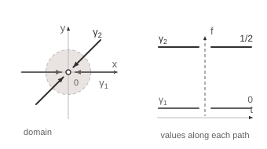
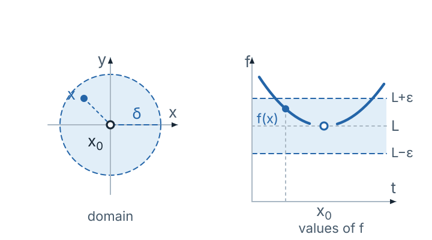
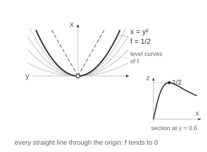

## Approaching a point in several variables

For a function of one real variable, the point $x$ can approach $a$ from the left or from the right, and the limit exists only when both one-sided limits agree. In two or more variables the situation changes qualitatively: a point $(x,y)$ can approach $(x_0,y_0)$ along infinitely many curves, and the function may behave differently along each of them. A limit exists only when every possible approach produces the same value.

The standard example is the function

$$f(x,y)=\frac{xy}{x^2+y^2}$$

defined for $(x,y)\neq(0,0)$. Along the $x$-axis, where $y=0$, the function vanishes:

$$f(x,0)=\frac{x\cdot 0}{x^2+0}=0 \qquad x\neq 0$$

Along the line $y=x$, however,

$$f(x,x)=\frac{x^2}{x^2+x^2}=\frac{1}{2} \qquad x\neq 0$$

The two approaches give different values, $0$ and $1/2$, so no single number can be the limit.

This phenomenon has no counterpart in one variable: there the domain of approach is one-dimensional, while here it is a punctured disc.

## Definition of limit

Let $A\subseteq\mathbb{R}^n$ and let $f:A\to\mathbb{R}$. A point $x_0\in\mathbb{R}^n$ is an accumulation point of $A$ if every punctured ball centred at $x_0$ contains at least one point of $A$. Only accumulation points can be approached from within the domain.

+ Let $x_0$ be an accumulation point of $A$ and let $L\in\mathbb{R}$.

The limit of $f$ at $x_0$ is $L$, written

$$\lim_{x\to x_0} f(x)=L \tag{1}$$

if for every $\varepsilon>0$ there exists $\delta>0$ such that

$$x\in A \quad\text{and}\quad 0<\|x-x_0\|<\delta \quad\Longrightarrow\quad |f(x)-L|<\varepsilon$$

The definition deserves three comments.

+ The value $f(x_0)$ need not exist, and when it does exist it plays no role. The condition excludes $x=x_0$ and controls only nearby points.
+ The point $x_0$ must be an accumulation point of $A$. If $x_0$ were isolated in $A$, the condition $0<\|x-x_0\|<\delta$ would select no point of $A$ for small $\delta$, and every real number would satisfy the definition.
+ The Euclidean norm is used for concreteness. Any norm equivalent to it gives the same limit, because the definition compares only distances and a change of norm changes $\delta$ but not the existence or the value of the limit.

For $n=2$, with $x=(x,y)$ and $x_0=(x_0,y_0)$, the condition reads

$$\|x-x_0\|=\sqrt{(x-x_0)^2+(y-y_0)^2}$$

so the punctured ball is a disc with its centre removed.

A limit, when it exists, is unique. Suppose that both $L$ and $M$ satisfied (1) with $L\neq M$. Choose $\varepsilon=|L-M|/3$. The definition supplies $\delta_L$ and $\delta_M$; since $x_0$ is an accumulation point, there is a point $x\in A$ with $0<\|x-x_0\|<\min(\delta_L,\delta_M)$. For this point the triangle inequality gives

$$|L-M|\le |L-f(x)|+|f(x)-M|<\frac{2|L-M|}{3}$$

which is impossible. Hence $L=M$.

## The sequential criterion

Limits of several variables can be tested with sequences, and this reformulation is often the shortest route to a proof of nonexistence.

+ A sequence $(x_k)$ in $A\setminus\{x_0\}$ converges to $x_0$ if $\|x_k-x_0\|\to 0$.

The limit $\lim_{x\to x_0}f(x)=L$ exists if and only if, for every such sequence, $f(x_k)\to L$.

For the direct implication, fix $\varepsilon>0$ and take $\delta$ from the definition. Since $x_k\to x_0$, all sufficiently large indices satisfy $0<\|x_k-x_0\|<\delta$, and therefore $|f(x_k)-L|<\varepsilon$. For the converse, suppose that the limit is not $L$. Then there is $\varepsilon_0>0$ such that for every $k$ one can choose $x_k\in A$ with

$$0<\|x_k-x_0\|<\frac{1}{k} \qquad\text{and}\qquad |f(x_k)-L|\ge\varepsilon_0$$

The sequence $(x_k)$ converges to $x_0$, but $(f(x_k))$ does not converge to $L$. This proves the contrapositive.

## Limit laws and continuity

The usual algebra of limits carries over without change. If $f$ and $g$ have finite limits at $x_0$, then

$$\lim_{x\to x_0}\bigl(f(x)+g(x)\bigr)=\lim_{x\to x_0}f(x)+\lim_{x\to x_0}g(x)$$

and the analogous statements hold for differences, constant multiples, products and quotients with non-zero denominator. The composition law also holds: if $g(x)\to L$ and a one-variable function $\varphi$ is continuous at $L$, then $\varphi(g(x))\to\varphi(L)$.

Coordinate functions are continuous, since $|x_i-(x_0)_i|\le\|x-x_0\|$. Sums and products of continuous functions are continuous, so every polynomial in $n$ variables is continuous on $\mathbb{R}^n$. A rational function is continuous wherever its denominator does not vanish. For example,

$$f(x,y)=x^2y+3xy^2-2$$

is continuous on $\mathbb{R}^2$, while

$$g(x,y)=\frac{x+y}{x^2-y^2}$$

is continuous on the open set where $x^2\neq y^2$, that is, away from the two lines $y=x$ and $y=-x$.

A function $f:A\to\mathbb{R}$ is continuous at $x_0\in A$ if

$$\lim_{x\to x_0}f(x)=f(x_0)$$

and continuous on $A$ if this holds at every point of $A$. The definition requires $x_0$ to belong to $A$, unlike the definition of limit. Continuity is a local property: it depends only on the values of $f$ in an arbitrarily small neighbourhood of the point.

## Proving that a limit exists

Direct use of the definition requires a candidate value and an estimate. Two devices shorten the work: inequalities that reduce the expression to a function of $\|x-x_0\|$, and polar coordinates with a bound uniform in the angle.

Consider first

$$\lim_{(x,y)\to(0,0)}\frac{x^2y}{x^2+y^2}$$

Since $x^2\le x^2+y^2$, for $(x,y)\neq(0,0)$,

$$\left|\frac{x^2y}{x^2+y^2}\right|\le |y|\le \sqrt{x^2+y^2}$$

Given $\varepsilon>0$, choose $\delta=\varepsilon$. If $0<\sqrt{x^2+y^2}<\delta$, then the left-hand side is smaller than $\varepsilon$, so the limit is $0$. The same estimate proves the stronger statement that the function tends to $0$ uniformly in the direction of approach.

A second example uses a sharper inequality. For

$$\lim_{(x,y)\to(0,0)}\frac{x^2y^2}{x^2+y^2}$$

the elementary inequality $4x^2y^2\le(x^2+y^2)^2$ gives

$$0\le\frac{x^2y^2}{x^2+y^2}\le\frac{x^2+y^2}{4}$$

The right-hand side is $r^2/4$ with $r=\sqrt{x^2+y^2}$, which tends to $0$. Hence the limit is $0$.

Polar coordinates make the radial structure explicit. Write

$$x=x_0+r\cos\theta \qquad y=y_0+r\sin\theta \qquad r>0$$

and suppose that

$$f(x_0+r\cos\theta,y_0+r\sin\theta)=g(r,\theta)$$

If there is a function $h$ with $h(r)\to 0$ as $r\to 0^+$ such that

$$|g(r,\theta)-L|\le h(r) \qquad\text{for every }\theta$$

then $\lim_{(x,y)\to(x_0,y_0)}f(x,y)=L$. Indeed, $|f(x,y)-L|\le h(\|(x,y)-(x_0,y_0)\|)$, and the bound is independent of the angle.

The uniformity in $\theta$ is essential. Writing a function in polar coordinates does not by itself prove anything, because the angular dependence may prevent a bound that depends on $r$ alone. The function

$$f(x,y)=\frac{xy^2}{x^2+y^4}$$

illustrates the point. In polar form,

$$g(r,\theta)=\frac{r\cos\theta\sin^2\theta}{\cos^2\theta+r^2\sin^4\theta}$$

which has no bound depending only on $r$ near $\theta=\pi/2$. The denominator can vanish at the origin for a direction that depends on $r$, and the quotient can approach $1/2$ along a curve, as the next section shows.

A useful radial example is

$$\lim_{(x,y)\to(0,0)}\frac{\sin(x^2+y^2)}{x^2+y^2}$$

Put $t=x^2+y^2$. As $(x,y)\to(0,0)$ we have $t\to0^+$, and the one-variable limit $\sin t/t\to1$ applies. Composition with the continuous function $t=x^2+y^2$ gives limit $1$. Defining the value at the origin to be $1$ produces a continuous extension.

## Proving that a limit does not exist

A single pair of paths with different limits is enough to disprove existence. The following statement makes this precise.

+ Let $\gamma_1,\gamma_2:(-\eta,\eta)\to A$ be continuous curves with $\gamma_i(t)\neq x_0$ for $t\neq0$ and $\gamma_i(t)\to x_0$ as $t\to0$.
+ If $f(\gamma_i(t))\to L_i$ as $t\to0$ and $L_1\neq L_2$, then $\lim_{x\to x_0}f(x)$ does not exist.

Indeed, if the limit existed and equalled $L$, composition with each curve would give $f(\gamma_i(t))\to L$, hence $L_1=L=L_2$, contrary to the hypothesis.

The function $xy/(x^2+y^2)$ has already been treated with the paths $y=0$ and $y=x$. A second example is

$$f(x,y)=\frac{x^2-y^2}{x^2+y^2}$$

Along the $x$-axis, $f(x,0)=1$ for $x\neq0$, while along the $y$-axis, $f(0,y)=-1$ for $y\neq0$. The two values differ, so the limit at the origin does not exist.

The third example shows that checking straight lines is insufficient. For

$$f(x,y)=\frac{xy^2}{x^2+y^4}$$

every line through the origin gives limit $0$. Along $y=mx$ with $m\neq0$,

$$f(x,mx)=\frac{m^2x^3}{x^2+m^4x^4}=\frac{m^2x}{1+m^4x^2}\longrightarrow 0$$

and the coordinate axes also give $0$. Yet along the parabola $x=y^2$, parametrised by $(x,y)=(t^2,t)$,

$$f(t^2,t)=\frac{t^2\cdot t^2}{t^4+t^4}=\frac{1}{2} \qquad t\neq 0$$

so the limit along this curve is $1/2$. Hence the limit does not exist, even though all linear approaches agree.

A finite list of paths, however long, can never prove that a limit exists; it can only disprove it.

## Iterated limits

A function of two variables admits two iterated limits,

$$\lim_{x\to x_0}\left(\lim_{y\to y_0}f(x,y)\right) \qquad\text{and}\qquad \lim_{y\to y_0}\left(\lim_{x\to x_0}f(x,y)\right)$$

in which the variables tend to their limits one after the other. These are distinct from the simultaneous limit (1), and neither determines the other in general.

If the simultaneous limit $L$ exists and the inner limit exists for every $x$ near $x_0$, then the corresponding iterated limit exists and equals $L$. To see this, fix $\varepsilon>0$ and choose $\delta$ so that $|f(x,y)-L|<\varepsilon$ whenever $0<\|(x,y)-(x_0,y_0)\|<\delta$. For $0<|x-x_0|<\delta$, let $y\to y_0$ in this inequality; the inner limit, when it exists, is also bounded by $\varepsilon$ from $L$. Hence the outer limit is $L$.

The converse fails. For $f(x,y)=xy/(x^2+y^2)$, both inner limits are $0$ for every fixed value of the other variable, so both iterated limits are $0$. The simultaneous limit does not exist. Iterated limits therefore provide necessary conditions at best.

The two orders can also differ from each other, and a simultaneous limit may exist while an iterated one fails. For

$$f(x,y)=x\sin\frac{1}{y} \qquad y\neq0$$

the estimate $|f(x,y)|\le|x|$ shows that the simultaneous limit at the origin is $0$. For fixed $x\neq0$, however, $\sin(1/y)$ has no limit as $y\to0$, so the inner limit in $\lim_{x\to0}\lim_{y\to0}f(x,y)$ does not exist.

## Continuity on compact sets

Continuity interacts with the topology of the domain in the same way as in one variable. The image of a compact set under a continuous function is compact, so a continuous real-valued function on a compact subset $K\subseteq\mathbb{R}^n$ is bounded and attains its maximum and minimum on $K$. The image of a connected set is connected, which yields an intermediate-value property along curves.

For example, the function $f(x,y)=x^2+y^2$ is continuous on the closed disc $D=\{(x,y):x^2+y^2\le1\}$. The disc is compact, and $f$ attains the value $0$ at the origin and the value $1$ on the boundary circle. Neither conclusion follows from continuity alone on a non-compact domain: on the open disc, the same function is bounded but does not attain the value $1$.

## How to investigate a limit

The following checklist summarises the methods above. It is a guide to the order in which they are usually tried, not a substitute for a proof.

+ Substitute the point when the expression is defined there and the denominator does not vanish.
+ For a rational function whose denominator vanishes at the point, compare the degrees of numerator and denominator, or bound the expression by a power of $\|x-x_0\|$.
+ Use polar coordinates only when the resulting estimate is uniform in the angle.
+ To disprove existence, exhibit two curves with different limits. Axes, lines, parabolas such as $x=y^2$, and cubics are the usual candidates.
+ Treat iterated limits as evidence, not as proof: they may exist and disagree with the simultaneous limit, or fail while it exists.
+ Once an estimate of the form $|f(x)-L|\le h(\|x-x_0\|)$ with $h(r)\to0$ is available, the definition supplies the conclusion.

The limit is the input to continuity and differentiability. The next step is to differentiate with respect to one variable at a time, as in the entry on [partial derivatives](../partial-derivatives/), and then to assemble those derivatives into the [tangent plane and linear approximation](../tangent-planes-and-linear-approximations/) of a graph.
