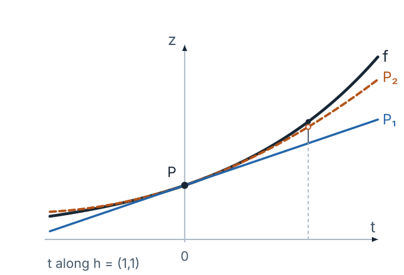
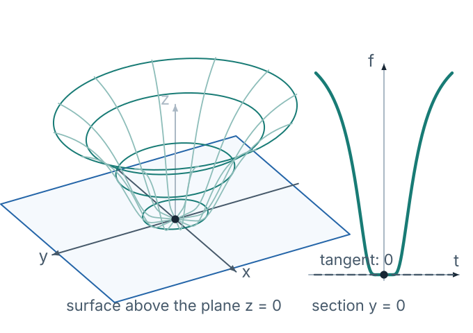
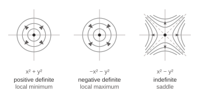

## From the tangent plane to higher-order approximations

For a function of one variable, the Taylor polynomial of order $k$ at a point matches the value of the function and its first $k$ derivatives there. The same principle applies to a function $f:A\subseteq\mathbb{R}^n\to\mathbb{R}$, but the number of derivatives to be matched grows quickly with the dimension. In two variables there are two first derivatives, three second derivatives and four third derivatives; in $n$ variables the count is the number of multi-indices of the appropriate order.

The first-order Taylor polynomial is the linear approximation studied in the entry on [tangent planes and linear approximations](../tangent-planes-and-linear-approximations/). The second-order polynomial adds the curvature described by the Hessian matrix, and higher orders refine the approximation further. The purpose of this entry is to state the general expansion, explain the meaning of its remainder, and show how to compute it without differentiating every monomial separately.

## Multi-index notation

A multi-index is a vector $\alpha=(\alpha_1,\ldots,\alpha_n)$ whose entries are non-negative integers. Its order, factorial and power are defined by

$$|\alpha|=\alpha_1+\cdots+\alpha_n \qquad \alpha!=\alpha_1!\cdots\alpha_n! \qquad h^\alpha=h_1^{\alpha_1}\cdots h_n^{\alpha_n}$$

for $h=(h_1,\ldots,h_n)\in\mathbb{R}^n$. The partial derivative of order $|\alpha|$ is written

$$\partial^\alpha f=\frac{\partial^{|\alpha|}f}{\partial x_1^{\alpha_1}\cdots\partial x_n^{\alpha_n}}$$

with the convention that $\partial^{(0,\ldots,0)}f=f$. For $n=2$ and $\alpha=(2,1)$, for instance,

$$|\alpha|=3 \qquad \alpha!=2 \qquad h^\alpha=h_1^2h_2 \qquad \partial^\alpha f=\frac{\partial^3 f}{\partial x_1^2\partial x_2}$$

The number of multi-indices with $|\alpha|=k$ is $\binom{n+k-1}{k}$, and the number with $|\alpha|\le k$ is $\binom{n+k}{k}$. For $n=2$ and $k=2$ the latter gives $\binom{4}{2}=6$: the constant term, two linear terms and three quadratic terms.

## The first-order expansion

Let $A\subseteq\mathbb{R}^n$ be open, let $f:A\to\mathbb{R}$ and let $a\in A$. The function $f$ is differentiable at $a$ if there is a vector $\nabla f(a)\in\mathbb{R}^n$ such that

$$f(a+h)=f(a)+\nabla f(a)\cdot h+o(\|h\|) \qquad h\to0 \tag{1}$$

The vector $\nabla f(a)$ is the gradient, whose components are the partial derivatives $\partial f/\partial x_i(a)$: taking $h=te_i$ in (1) and letting $t\to0$ isolates the $i$-th component. The little-o symbol means that the difference between $f(a+h)$ and the linear expression, divided by $\|h\|$, tends to $0$. Equivalently,

$$\lim_{h\to0}\frac{f(a+h)-f(a)-\nabla f(a)\cdot h}{\|h\|}=0$$

The first-order Taylor polynomial of $f$ at $a$ is therefore

$$P_{a,1}(h)=f(a)+\nabla f(a)\cdot h$$

and its graph is the tangent plane to the graph of $f$ at $(a,f(a))$. The condition (1) is stronger than the existence of the partial derivatives: it requires the linear expression to approximate $f$ uniformly in every direction, not only along the coordinate axes.

## The second-order expansion

Let $f$ be of class $C^2$ on an open set $A$, and let $a\in A$. The Hessian matrix at $a$ is the symmetric $n\times n$ matrix

$$H_f(a)=\left(\frac{\partial^2 f}{\partial x_i\partial x_j}(a)\right)_{i,j=1}^{n}$$

Symmetry follows from the equality of mixed partial derivatives, which holds under the $C^2$ hypothesis.

For $h$ such that the segment from $a$ to $a+h$ lies in $A$, there exists $\theta\in(0,1)$ with

$$f(a+h)=f(a)+\nabla f(a)\cdot h+\frac{1}{2}h^{T}H_f(a+\theta h)h \tag{2}$$

This is the second-order Taylor formula with Lagrange remainder. Its proof reduces the problem to one variable. Define

$$\varphi(t)=f(a+th) \qquad 0\le t\le1$$

Then $\varphi$ is of class $C^2$ on $[0,1]$, and the chain rule gives

$$\varphi'(t)=\nabla f(a+th)\cdot h \qquad \varphi''(t)=h^{T}H_f(a+th)h$$

The one-variable Taylor formula of order one, applied on the interval $[0,1]$, states that

$$\varphi(1)=\varphi(0)+\varphi'(0)+\frac{1}{2}\varphi''(\theta)$$

for some $\theta\in(0,1)$. Substituting the three expressions yields (2).

Expanding the quadratic term gives, in coordinates,

$$f(a+h)=f(a)+\sum_{i=1}^{n}\frac{\partial f}{\partial x_i}(a)h_i+\frac{1}{2}\sum_{i,j=1}^{n}\frac{\partial^2 f}{\partial x_i\partial x_j}(a)h_ih_j+R_2(h)$$

where the remainder is

$$R_2(h)=\frac{1}{2}\sum_{i,j=1}^{n}\left(\frac{\partial^2 f}{\partial x_i\partial x_j}(a+\theta h)-\frac{\partial^2 f}{\partial x_i\partial x_j}(a)\right)h_ih_j$$

Since the second partial derivatives are continuous at $a$, the difference of Hessians tends to the zero matrix as $h\to0$. Hence

$$R_2(h)=o(\|h\|^2) \qquad h\to0$$

so the second-order Taylor polynomial is

$$P_{a,2}(h)=f(a)+\nabla f(a)\cdot h+\frac{1}{2}h^{T}H_f(a)h$$

For $n=2$, with $h=(h_1,h_2)$, this reads

$$
\begin{align}
f(a+h) &= f(a)+\frac{\partial f}{\partial x}(a)h_1+\frac{\partial f}{\partial y}(a)h_2 \\[6pt]
&\quad+\frac{1}{2}\left(\frac{\partial^2 f}{\partial x^2}(a)h_1^2+2\frac{\partial^2 f}{\partial x\partial y}(a)h_1h_2+\frac{\partial^2 f}{\partial y^2}(a)h_2^2\right)+o(\|h\|^2)
\end{align}
$$

The factor $2$ in the mixed term appears because the two mixed derivatives are equal, so the entries $(1,2)$ and $(2,1)$ of the Hessian contribute identical terms.

## The general Taylor theorem

The two forms of the remainder have different hypotheses and should be kept apart.

+ **Peano form.** Let $A\subseteq\mathbb{R}^n$ be open, let $f:A\to\mathbb{R}$ be of class $C^k$ and let $a\in A$. Then

$$f(a+h)=\sum_{|\alpha|\le k}\frac{\partial^\alpha f(a)}{\alpha!}h^\alpha+o(\|h\|^k) \qquad h\to0 \tag{3}$$

+ **Lagrange form.** Let $f$ be of class $C^{k+1}$ on $A$ and suppose that the segment from $a$ to $a+h$ lies in $A$. Then there exists $\theta\in(0,1)$ such that

$$f(a+h)=\sum_{|\alpha|\le k}\frac{\partial^\alpha f(a)}{\alpha!}h^\alpha+\sum_{|\alpha|=k+1}\frac{\partial^\alpha f(a+\theta h)}{\alpha!}h^\alpha \tag{4}$$

The polynomial

$$P_{a,k}(h)=\sum_{|\alpha|\le k}\frac{\partial^\alpha f(a)}{\alpha!}h^\alpha$$

is the Taylor polynomial of order $k$ of $f$ at $a$. It is the unique polynomial of degree at most $k$ whose partial derivatives of every order up to $k$ agree with those of $f$ at $a$. The uniqueness is what makes the shortcut in the next section legitimate.

The Lagrange form (4) is proved by the same reduction as the second-order case. Put $\varphi(t)=f(a+th)$ for $0\le t\le1$. The chain rule, applied repeatedly, gives

$$\varphi^{(j)}(t)=\sum_{|\alpha|=j}\frac{j!}{\alpha!}\partial^\alpha f(a+th)h^\alpha \qquad 0\le j\le k+1$$

The identity is proved by induction on $j$. For $j=0$ both sides equal $f(a+th)$. Differentiating the formula for $j$ produces, for a multi-index $\beta$ with $|\beta|=j+1$, the coefficient

$$\sum_{i:\,\beta_i\ge1}\frac{j!}{(\beta-e_i)!}=\frac{j!}{\beta!}\sum_{i:\,\beta_i\ge1}\beta_i=\frac{(j+1)!}{\beta!}$$

which is the coefficient required at order $j+1$. Here $e_i$ is the $i$-th standard basis vector, and the identity $\sum_i\beta_i=|\beta|=j+1$ has been used. The one-variable Taylor formula of order $k$ with Lagrange remainder, applied to $\varphi$ on $[0,1]$, now gives

$$\varphi(1)=\sum_{j=0}^{k}\frac{\varphi^{(j)}(0)}{j!}+\frac{\varphi^{(k+1)}(\theta)}{(k+1)!}$$

for some $\theta\in(0,1)$. Substituting the derivative formula at $t=0$ and at $t=\theta$ yields (4), because

$$\frac{\varphi^{(j)}(0)}{j!}=\sum_{|\alpha|=j}\frac{\partial^\alpha f(a)}{\alpha!}h^\alpha$$

and similarly for the term of order $k+1$.

The Peano form (3) is not a consequence of (4), since it assumes only $k$ continuous derivatives. Its proof uses a separate induction on the number of variables and is not reproduced here; the statement and proof are given in the [Toronto MAT237 notes](https://www.math.toronto.edu/courses/mat237y1/20199/notes/Chapter2/S2.6.html). For $k=2$ the Peano form was proved above directly from (2), so the quadratic case is complete within this entry.

## Computing Taylor polynomials in practice

The definition requires the values of all partial derivatives up to order $k$. In practice one rarely computes them one by one. If $f$ is built from one-variable functions by sums, products and compositions, its Taylor polynomial is obtained by expanding those functions and discarding all terms of total degree greater than $k$. Uniqueness of the Taylor polynomial guarantees that the result is correct, provided the discarded terms are genuinely of higher total degree.

Consider

$$f(x,y)=e^x\cos y$$

at the origin, to order $3$. The one-variable expansions are

$$e^x=1+x+\frac{x^2}{2}+\frac{x^3}{6}+O(x^4) \qquad \cos y=1-\frac{y^2}{2}+O(y^4)$$

Multiplying and retaining terms of total degree at most $3$ gives

$$
\begin{align}
e^x\cos y &= \left(1+x+\frac{x^2}{2}+\frac{x^3}{6}\right)\left(1-\frac{y^2}{2}\right)+O(\|(x,y)\|^4) \\[6pt]
&= 1+x+\frac{x^2}{2}-\frac{y^2}{2}+\frac{x^3}{6}-\frac{xy^2}{2}+O(\|(x,y)\|^4)
\end{align}
$$

Hence

$$T_3(x,y)=1+x+\frac{x^2}{2}-\frac{y^2}{2}+\frac{x^3}{6}-\frac{xy^2}{2}$$

The derivative check confirms the coefficients. At the origin, $f=1$, $f_x=1$, $f_y=0$, $f_{xx}=1$, $f_{xy}=0$, $f_{yy}=-1$, $f_{xxx}=1$, $f_{xxy}=0$, $f_{xyy}=-1$ and $f_{yyy}=0$. Dividing by the factorials gives the displayed terms, including the coefficient $-1/2$ of $xy^2$ from $f_{xyy}(0,0)/2!=-1/2$. All omitted terms have total degree at least $4$.

A polynomial example shows the meaning of the remainder. Let

$$f(x,y)=x^2y+y^3 \qquad a=(1,1)$$

and write $x=1+h$, $y=1+k$. Direct expansion gives

$$f(1+h,1+k)=2+2h+4k+h^2+2hk+3k^2+h^2k+k^3$$

The Taylor polynomial of order $2$ is therefore

$$T_2(h,k)=2+2h+4k+h^2+2hk+3k^2$$

and the remainder is exactly $h^2k+k^3$, which is $o(\|(h,k)\|^2)$ but not zero. The same polynomial is obtained from the derivatives at $(1,1)$: $f=2$, $f_x=2$, $f_y=4$, $f_{xx}=2$, $f_{xy}=2$ and $f_{yy}=6$. Since $f$ is cubic, the expansion terminates at order $3$; there is no remainder of order $4$ or higher.

A third example uses composition with a single linear expression. For

$$f(x,y)=\sqrt{1+x+y}$$

at the origin, put $s=x+y$. The expansion $\sqrt{1+s}=1+\frac{s}{2}-\frac{s^2}{8}+O(s^3)$ gives

$$T_2(x,y)=1+\frac{x+y}{2}-\frac{(x+y)^2}{8}=1+\frac{x}{2}+\frac{y}{2}-\frac{x^2}{8}-\frac{xy}{4}-\frac{y^2}{8}$$

The gradient at the origin is $(1/2,1/2)$ and the Hessian is

$$H_f(0,0)=\begin{pmatrix}-\frac{1}{4}&-\frac{1}{4}\\-\frac{1}{4}&-\frac{1}{4}\end{pmatrix}$$

consistent with the displayed quadratic terms.

## Error bounds from the Lagrange remainder

The Lagrange form turns an expansion into a quantitative estimate once a bound on the derivatives of order $k+1$ is available. Consider

$$f(x,y)=e^{x+y} \qquad a=(0,0) \qquad k=2$$

All partial derivatives of order $3$ equal $e^{x+y}$, and the sum in (4) collapses because $f$ depends only on $s=x+y$:

$$T_2(x,y)=1+(x+y)+\frac{(x+y)^2}{2} \qquad R_2(x,y)=\frac{(x+y)^3}{6}e^{\xi}$$

where $\xi=\theta(x+y)$ for some $\theta\in(0,1)$. If $|x|\le0.1$ and $|y|\le0.1$, then $|x+y|\le0.2$ and $|\xi|\le0.2$, so

$$|R_2(x,y)|\le\frac{(0.2)^3}{6}e^{0.2}\approx1.63\times10^{-3}$$

At $(0.1,0.1)$ the exact value is $e^{0.2}\approx1.22140$ and the quadratic polynomial gives $1.22$; the error $1.40\times10^{-3}$ lies below the bound, as it must. A numerical check supports the estimate but does not replace it; the Lagrange formula supplies the proof.

## When the Taylor series does not represent the function

A function can be of class $C^\infty$ and still fail to equal the sum of its Taylor series. The standard example in two variables is

$$f(x,y)=
\begin{cases}
e^{-1/(x^2+y^2)} & (x,y)\neq(0,0) \\[6pt]
0 & (x,y)=(0,0)
\end{cases}$$

Every partial derivative of $f$ at the origin is zero. Along any line through the origin, $f$ reduces to $e^{-1/t^2}$ in the distance variable $t$, a function whose derivatives of every order vanish at $t=0$ faster than any power. Each partial derivative near the origin is bounded by a polynomial in $1/r$ times $e^{-1/r^2}$, with $r=\sqrt{x^2+y^2}$, and therefore tends to $0$ as $r\to0$.

Consequently every Taylor polynomial of $f$ at the origin is the zero polynomial, and the Taylor series converges to $0$ at every point. Yet $f(x,y)>0$ whenever $(x,y)\neq(0,0)$. The Taylor series exists but does not represent the function, and no finite-order expansion can detect the rise of the function away from the origin. Smoothness alone does not imply real analyticity in several variables, just as in one variable.

## Consequences and related notions

The second-order expansion is the basis for the classification of critical points. Suppose that $f$ is of class $C^2$ near $a$ and that $\nabla f(a)=0$. Then

$$f(a+h)=f(a)+\frac{1}{2}h^{T}H_f(a)h+o(\|h\|^2)$$

and the sign of the quadratic form determines the local behaviour:

+ if $H_f(a)$ is positive definite, then $f$ has a strict local minimum at $a$;
+ if $H_f(a)$ is negative definite, then $f$ has a strict local maximum at $a$;
+ if $H_f(a)$ has both positive and negative eigenvalues, then $f$ has a saddle point at $a$;
+ if $H_f(a)$ is singular, the second-order term is inconclusive and higher-order terms decide.

The first-order polynomial is the tangent plane, and the second-order polynomial is the quadratic surface that shares the same tangent plane and the same second derivatives. The entry on [partial derivatives](../partial-derivatives/) develops the Hessian and the symmetry of mixed derivatives used here, while the entry on [Taylor's formula with remainder](../taylor-formula-with-remainder/) treats the one-variable case in detail.
