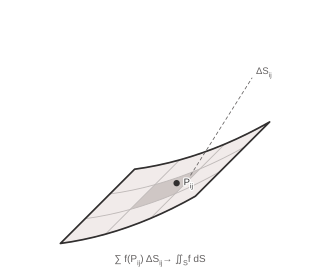
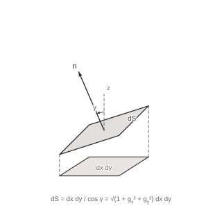
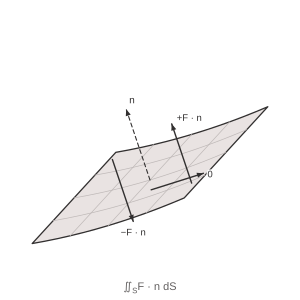

## Integrating over a surface

A double integral adds values over a flat region. A surface integral adds values over a curved two-dimensional set in space. The construction follows the same pattern as the double integral and the line integral: partition the surface, sample the integrand, multiply by a small area, and pass to a limit.

Let $S$ be a piecewise smooth surface and let $f$ be a continuous scalar function defined on $S.$ Partition $S$ into patches $S_{ij}$ of area $\Delta S_{ij},$ choose a sample point $P_{ij}$ in each patch, and form the sum

$$\sum_{i,j}f(P_{ij})\,\Delta S_{ij} \tag{1}$$

As the partition is refined so that the largest patch diameter tends to zero, the sums converge to the **scalar surface integral** of $f$ over $S,$ written

$$\iint_S f\,dS \tag{2}$$

The element $dS$ is surface area, not projected area. It is nonnegative, and the integral does not depend on an orientation of $S.$ Reversing the normal, if one has been chosen, leaves a scalar surface integral unchanged.

The simplest case is $f=1,$ for which

$$\iint_S dS=A(S) \tag{3}$$

is the area of the surface. This is the two-dimensional analogue of $\int_C ds=L,$ the arc length of a curve. The scalar surface integral generalizes surface area in the same way that a weighted integral generalizes length.

The integral is linear and additive:

$$\iint_S(\alpha f+\beta g)\,dS=\alpha\iint_S f\,dS+\beta\iint_S g\,dS \tag{4}$$

and if $S$ is the union of two patches that meet along a curve,

$$\iint_S f\,dS=\iint_{S_1}f\,dS+\iint_{S_2}f\,dS \tag{5}$$

The intersection has zero area and contributes nothing.

## Evaluating with a parameterization

The definition is geometric but not directly computable. A parameterization turns the surface integral into a double integral over a region in the plane. Let

$$\mathbf{r}(u,v)=\langle x(u,v),y(u,v),z(u,v)\rangle \qquad (u,v)\in D \tag{6}$$

be a smooth parameterization that traces $S$ once, apart from its boundary. Then

$$\iint_S f\,dS=\iint_D f(\mathbf{r}(u,v))\,\lVert\mathbf{r}_u\times\mathbf{r}_v\rVert\,du\,dv \tag{7}$$

The factor $\lVert\mathbf{r}_u\times\mathbf{r}_v\rVert$ converts parameter area to surface area. It is the area of the parallelogram spanned by the tangent vectors to the coordinate curves, and it plays the role that $\lVert\mathbf{r}'(t)\rVert$ plays for a curve.

If the parameterization is not one-to-one, the integral counts the surface with multiplicity. A parameterization that traces a sphere twice gives twice the integral of a one-to-one parameterization. The hypothesis that $S$ is traced once is therefore part of the evaluation formula, not a cosmetic assumption.

The value is independent of the parameterization chosen, provided each traces the surface once. A change of parameters multiplies both the integrand's area factor and the parameter area element by the absolute value of the Jacobian determinant, and the two factors cancel.

## Graphs and implicit surfaces

Most surfaces in elementary problems are graphs. If $S$ is the graph of $z=g(x,y)$ over a region $D,$ the standard parameterization is $\mathbf{r}(x,y)=\langle x,y,g(x,y)\rangle,$ and

$$\lVert\mathbf{r}_x\times\mathbf{r}_y\rVert=\sqrt{1+g_x^2+g_y^2} \tag{8}$$

so

$$\iint_S f\,dS=\iint_D f(x,y,g(x,y))\,\sqrt{1+g_x^2+g_y^2}\,dx\,dy \tag{9}$$

The square root is the factor by which the tilted surface exceeds its projection onto the $xy$-plane. For a horizontal plane it equals $1;$ for a steep surface it is large.

If the surface is given implicitly by $F(x,y,z)=0$ with $F_z\neq0,$ the same argument with the normal $\nabla F$ gives

$$dS=\frac{\lVert\nabla F\rVert}{|F_z|}\,dx\,dy \tag{10}$$

because the angle between the normal and the $z$-axis has cosine $|F_z|/\lVert\nabla F\rVert.$ The formula (9) is the special case $F(x,y,z)=z-g(x,y),$ for which $\lVert\nabla F\rVert=\sqrt{1+g_x^2+g_y^2}$ and $|F_z|=1.$

## A hemisphere

Let $S$ be the upper hemisphere of radius $2,$

$$\mathbf{r}(\theta,\varphi)=\langle2\sin\varphi\cos\theta,\ 2\sin\varphi\sin\theta,\ 2\cos\varphi\rangle \tag{11}$$

with $0\le\theta\le2\pi$ and $0\le\varphi\le\pi/2.$ The area element is

$$\lVert\mathbf{r}_\theta\times\mathbf{r}_\varphi\rVert=4\sin\varphi \tag{12}$$

and $z=2\cos\varphi.$ Hence

$$\iint_S z\,dS=\int_0^{2\pi}\int_0^{\pi/2}(2\cos\varphi)(4\sin\varphi)\,d\varphi\,d\theta \tag{13}$$

The inner integral is

$$\int_0^{\pi/2}8\sin\varphi\cos\varphi\,d\varphi=4\bigl[\sin^2\varphi\bigr]_0^{\pi/2}=4 \tag{14}$$

so

$$\iint_S z\,dS=2\pi\cdot4=8\pi \tag{15}$$

The area of the upper hemisphere is $2\pi(2)^2=8\pi,$ so the average value of $z$ on this hemisphere is $1.$ That is half the radius, which is plausible by symmetry: the upper hemisphere is weighted toward its equator, not its pole.

As a second check, the same computation with $f=1$ gives

$$\iint_S dS=\int_0^{2\pi}\int_0^{\pi/2}4\sin\varphi\,d\varphi\,d\theta=2\pi\cdot4=8\pi \tag{16}$$

in agreement with $2\pi R^2.$

## A sphere and a cone

For the unit sphere, take $f=x^2.$ With $x=\sin\varphi\cos\theta$ and area element $\sin\varphi,$

$$\iint_S x^2\,dS=\int_0^{2\pi}\int_0^\pi\sin^3\varphi\cos^2\theta\,d\varphi\,d\theta \tag{17}$$

The integrals separate:

$$\int_0^{2\pi}\cos^2\theta\,d\theta=\pi \qquad \int_0^\pi\sin^3\varphi\,d\varphi=\frac43 \tag{18}$$

so the integral is $4\pi/3.$ By symmetry the integrals of $y^2$ and $z^2$ are equal, and their sum is the integral of $x^2+y^2+z^2=1$ over the unit sphere, which is $4\pi.$ Each is therefore $4\pi/3,$ consistent with the average value $1/3$ of each coordinate square on the sphere.

For a conical shell

$$\mathbf{r}(r,\theta)=\langle r\cos\theta,\ r\sin\theta,\ r\rangle \qquad 0\le r\le R,\quad 0\le\theta\le2\pi \tag{19}$$

the area element is $\sqrt2\,r\,dr\,d\theta,$ as computed in the entry on parametric surfaces. If the shell has density $\rho(x,y,z)=z=r,$ its mass is

$$M=\iint_S z\,dS=\int_0^{2\pi}\int_0^R r\,(\sqrt2\,r)\,dr\,d\theta=2\pi\sqrt2\int_0^Rr^2\,dr=\frac{2\sqrt2}{3}\pi R^3 \tag{20}$$

The result has the dimensions of density times area, and it is positive, as a mass must be. The vertex contributes nothing because the area element vanishes there.

## Mass, centre of mass and average value

The physical readings parallel those of the line integral. If a thin shell has surface density $\rho(x,y,z),$ its mass is

$$M=\iint_S\rho\,dS \tag{21}$$

and its centre of mass is

$$\bar{x}=\frac1M\iint_S x\rho\,dS \qquad \bar{y}=\frac1M\iint_S y\rho\,dS \qquad \bar{z}=\frac1M\iint_S z\rho\,dS \tag{22}$$

The average value of $f$ over $S$ is

$$f_{\mathrm{avg}}=\frac1{A(S)}\iint_S f\,dS \tag{23}$$

For a uniform hemisphere of radius $R,$ the centre of mass lies on the axis of symmetry at height $R/2.$ The computation is a scalar surface integral of $z$ divided by the area, and the value $R/2$ follows from the same integral as (15) with general $R.$

These formulas are the surface analogues of the corresponding formulas for wire, area and volume. The dimension of the integral is the dimension of $f$ times area; a surface has no thickness, so there is no volume factor.

## Vector surface integrals

A vector surface integral integrates the normal component of a vector field. It requires an orientation, because the sign of the normal component depends on which side of the surface is chosen.

Let $S$ be an oriented smooth surface with unit normal $\mathbf{n}.$ The **vector surface integral** of $\mathbf{F}$ over $S$ is

$$\iint_S\mathbf{F}\cdot d\mathbf{S}=\iint_S\mathbf{F}\cdot\mathbf{n}\,dS \tag{24}$$

The notation $d\mathbf{S}=\mathbf{n}\,dS$ packages the normal and the area element. If $S$ is parameterized by $\mathbf{r}(u,v),$ then

$$\mathbf{n}\,dS=(\mathbf{r}_u\times\mathbf{r}_v)\,du\,dv \tag{25}$$

for the orientation determined by the order $(u,v),$ and therefore

$$\iint_S\mathbf{F}\cdot d\mathbf{S}=\iint_D\mathbf{F}(\mathbf{r}(u,v))\cdot(\mathbf{r}_u\times\mathbf{r}_v)\,du\,dv \tag{26}$$

Reversing the orientation changes the sign. Swapping $u$ and $v$ reverses the cross product and hence the sign; using $(\mathbf{r}_v\times\mathbf{r}_u)$ is the same as reversing the orientation.

The vector surface integral is also called the **flux** of $\mathbf{F}$ across $S.$ Only the component of $\mathbf{F}$ normal to the surface contributes; a field tangent to the surface has zero flux, however large it is. The scalar surface integral of $\lVert\mathbf{F}\rVert$ is a different quantity: it is nonnegative, and it bounds the magnitude of the flux without recording its sign.

For a closed surface, the standard orientation is outward. The outward normal points away from the enclosed solid, and the flux is then the net flow out of the solid per unit time when $\mathbf{F}$ is a velocity field.

## Flux through a hemisphere

Let $S$ be the upper hemisphere of radius $R$ with outward orientation, and let

$$\mathbf{F}(x,y,z)=\langle0,0,z\rangle \tag{27}$$

Using the parameterization (11) with general $R,$ the outward normal is $\mathbf{r}_\varphi\times\mathbf{r}_\theta,$ the negative of (19), and

$$\mathbf{F}\cdot(\mathbf{r}_\varphi\times\mathbf{r}_\theta)=R^3\sin\varphi\cos^2\varphi \tag{28}$$

Hence

$$\iint_S\mathbf{F}\cdot d\mathbf{S}=\int_0^{2\pi}\int_0^{\pi/2}R^3\sin\varphi\cos^2\varphi\,d\varphi\,d\theta=2\pi R^3\left[-\frac{\cos^3\varphi}{3}\right]_0^{\pi/2}=\frac{2\pi R^3}{3} \tag{29}$$

The same result follows from the graph description. On the upper hemisphere $z=\sqrt{R^2-x^2-y^2},$ the upward normal area element is $d\mathbf{S}=\langle-g_x,-g_y,1\rangle\,dx\,dy,$ and $\mathbf{F}\cdot d\mathbf{S}=z\,dx\,dy.$ Integrating $z$ over the disk of radius $R$ in polar coordinates gives

$$\int_0^{2\pi}\int_0^R\sqrt{R^2-r^2}\,r\,dr\,d\theta=\frac{2\pi R^3}{3} \tag{30}$$

The two computations agree. The second is shorter here because the field has only a vertical component, but the first shows how the orientation enters through the cross product.

## Piecewise surfaces

A piecewise smooth surface is integrated patch by patch:

$$\iint_S=\iint_{S_1}+\cdots+\iint_{S_n} \tag{31}$$

with each patch given its own orientation. For a closed surface, every patch is oriented outward. A cube, for example, has six faces, and the outward normal is constant on each face but different from face to face. The joins have zero area and do not contribute.

The orientation of adjacent patches must be consistent if the surface is to be treated as one oriented surface. Two patches that meet along an edge should induce opposite directions along the shared edge when their boundary curves are oriented by the normal; otherwise the surface integral is not well defined as a single flux. For a closed surface the outward convention removes the ambiguity.

## What surface integrals do not say

+ The area element $dS$ is not $dx\,dy.$ The projection factor $\sqrt{1+g_x^2+g_y^2}$ is essential; omitting it computes the integral over the shadow of the surface, not over the surface.
+ A scalar surface integral is orientation-independent; a vector surface integral is not. Reversing the normal changes the sign of the flux but not the value of $\iint f\,dS.$
+ The integral of $f=1$ is area, not volume. A surface has zero thickness, and no volume element appears.
+ A zero flux does not imply a zero field. A field tangent to the surface, or a field that enters on one side and leaves on another, can have zero net flux.
+ A parameterization that is not one-to-one counts the surface more than once. The evaluation formula assumes a single tracing, apart from boundary identifications.
+ A coordinate singularity at isolated points does not invalidate the integral, provided the area element vanishes there and the integrand is bounded. A genuine geometric singularity may require splitting the surface.
+ Not every surface is a graph over the $xy$-plane. A sphere, a closed cylinder and a torus must be split into patches or parameterized directly.

- - -

Surface integrals combine the area element of a parametric surface with the integrand, and the vector form adds an orientation. The next step is to read the vector integral as the flux of a field through a surface and to connect the flux through a closed surface with the divergence inside.

## Related notions

The area element and normal vector come from [parametric surfaces](../parametric-surfaces/). The vector form is developed as the [flux integral](../flux-integrals/), and its relation to the [divergence](../divergence/) is the divergence theorem. The scalar form generalizes [double integrals](../double-integrals/) to curved domains, and the parameterizations connect to [cylindrical coordinates](../cylindrical-coordinates/) and [spherical coordinates](../spherical-coordinates/). The orientation convention is the same one used for [line integrals](../line-integrals/) and Stokes' theorem.
