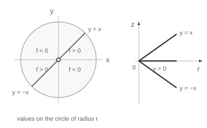
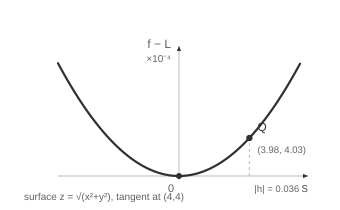

## From tangent lines to tangent planes

For a curve in the plane, differentiability at a point produces a tangent line whose slope is the derivative. For a surface in space the analogous object is a plane. A curve drawn on the surface and passing through a point $P$ has a tangent line at $P$; if the tangent lines of all such curves lie in one plane, that plane is the tangent plane to the surface at $P$.

For a surface that is the graph of a function $z=f(x,y)$, two curves through $P=(x_0,y_0,f(x_0,y_0))$ are immediately available: the intersections with the vertical planes $y=y_0$ and $x=x_0$. Their tangent lines have direction vectors

$$(1,0,f_x(x_0,y_0)) \qquad\text{and}\qquad (0,1,f_y(x_0,y_0))$$

provided the partial derivatives exist. The cross product of these vectors is

$$(1,0,f_x)\times(0,1,f_y)=(-f_x,-f_y,1)$$

so any plane containing both tangent lines has normal vector proportional to $(-f_x,-f_y,1)$. This computation produces a candidate plane. It produces the tangent plane only when the surface is smooth enough for every other curve on it to have its tangent line in the same plane, and that requirement is exactly differentiability.

## Differentiability at a point

Let $f$ be defined on an open set containing $(x_0,y_0)$. The function $f$ is differentiable at $(x_0,y_0)$ if there exist real numbers $a$ and $b$ such that

$$f(x_0+h,y_0+k)=f(x_0,y_0)+ah+bk+E(h,k) \tag{1}$$

where the error term satisfies

$$\lim_{(h,k)\to(0,0)}\frac{E(h,k)}{\sqrt{h^2+k^2}}=0$$

In the language of the previous entry, the error is $o\bigl(\sqrt{h^2+k^2}\bigr)$. The linear expression $f(x_0,y_0)+ah+bk$ is the candidate approximation, and differentiability says that it approximates $f$ to first order uniformly in the direction of $(h,k)$.

The coefficients are forced. Setting $k=0$ in (1) and dividing by $h$ gives

$$\frac{f(x_0+h,y_0)-f(x_0,y_0)}{h}=a+\frac{E(h,0)}{h}$$

Since $|E(h,0)|/|h|\le |E(h,0)|/\sqrt{h^2}=o(1)$, the left-hand side tends to $a$. Hence $a=f_x(x_0,y_0)$. Setting $h=0$ similarly gives $b=f_y(x_0,y_0)$. Therefore a differentiable function has partial derivatives at the point, and the only possible linear approximation is

$$L(x,y)=f(x_0,y_0)+f_x(x_0,y_0)(x-x_0)+f_y(x_0,y_0)(y-y_0) \tag{2}$$

Differentiability is stronger than the existence of the two partial derivatives. The partial derivatives record the behaviour along two coordinate directions only, while (1) controls all directions simultaneously.

Differentiability implies continuity. From (1),

$$|f(x_0+h,y_0+k)-f(x_0,y_0)|\le (|a|+|b|)\sqrt{h^2+k^2}+|E(h,k)|$$

and the right-hand side tends to $0$, so $f(x,y)\to f(x_0,y_0)$ as $(x,y)\to(x_0,y_0)$.

## A sufficient condition

Continuity of the partial derivatives is enough for differentiability. Suppose that $f_x$ and $f_y$ exist in a ball around $(x_0,y_0)$ and are continuous at $(x_0,y_0)$. For small $(h,k)$, write the increment as a sum of two changes, each in one variable:

$$
\begin{align}
f(x_0+h,y_0+k)-f(x_0,y_0) &= \bigl[f(x_0+h,y_0+k)-f(x_0,y_0+k)\bigr] \\[6pt]
&\quad+\bigl[f(x_0,y_0+k)-f(x_0,y_0)\bigr]
\end{align}
$$

The mean value theorem in the first variable, applied at fixed height $y_0+k$, gives

$$f(x_0+h,y_0+k)-f(x_0,y_0+k)=h f_x(\xi,y_0+k)$$

for some $\xi$ between $x_0$ and $x_0+h$. Applied in the second variable, it gives

$$f(x_0,y_0+k)-f(x_0,y_0)=k f_y(x_0,\eta)$$

for some $\eta$ between $y_0$ and $y_0+k$. Subtracting the linear expression (2) leaves

$$E(h,k)=h\bigl[f_x(\xi,y_0+k)-f_x(x_0,y_0)\bigr]+k\bigl[f_y(x_0,\eta)-f_y(x_0,y_0)\bigr]$$

Since $|h|$ and $|k|$ are at most $\sqrt{h^2+k^2}$, and since $(\xi,y_0+k)\to(x_0,y_0)$ and $(x_0,\eta)\to(x_0,y_0)$, continuity of the partial derivatives at $(x_0,y_0)$ gives

$$|E(h,k)|\le \sqrt{h^2+k^2}\,\bigl(\varepsilon+\varepsilon\bigr)$$

for $(h,k)$ sufficiently small. Hence $E=o\bigl(\sqrt{h^2+k^2}\bigr)$ and $f$ is differentiable.

The converse fails: continuity of the partial derivatives is sufficient but not necessary. A function can be differentiable at a point while its partial derivatives are discontinuous there.

## When partial derivatives are not enough

The function

$$f(x,y)=
\begin{cases}
\dfrac{xy}{\sqrt{x^2+y^2}} & (x,y)\neq(0,0) \\[6pt]
0 & (x,y)=(0,0)
\end{cases}$$

is continuous at the origin, because

$$|f(x,y)|\le\frac{1}{2}\sqrt{x^2+y^2}$$

by the inequality $2|xy|\le x^2+y^2$. Its partial derivatives at the origin both vanish, since $f(h,0)=0$ and $f(0,k)=0$ for all $h,k$. If $f$ were differentiable at the origin, the linear approximation would be the zero function and (1) would require

$$\frac{f(h,k)}{\sqrt{h^2+k^2}}=\frac{hk}{h^2+k^2}\longrightarrow0$$

But along $h=k$ the quotient equals $1/2$, and along $h=0$ it equals $0$. The limit does not exist, so $f$ is not differentiable at the origin. Its graph has no tangent plane there, even though both coordinate sections are flat.

The stronger failure is discontinuity. For

$$g(x,y)=
\begin{cases}
\dfrac{xy}{x^2+y^2} & (x,y)\neq(0,0) \\[6pt]
0 & (x,y)=(0,0)
\end{cases}$$

the partial derivatives at the origin again vanish, but $g$ is not even continuous there, as the paths $y=0$ and $y=x$ show. A discontinuous function cannot be differentiable, so no tangent plane exists.

## Equation of the tangent plane

When $f$ is differentiable at $(x_0,y_0)$, the graph of the linear approximation (2) is the tangent plane. Writing $z_0=f(x_0,y_0)$, its equation is

$$z=z_0+f_x(x_0,y_0)(x-x_0)+f_y(x_0,y_0)(y-y_0) \tag{3}$$

Equivalently,

$$f_x(x_0,y_0)(x-x_0)+f_y(x_0,y_0)(y-y_0)-(z-z_0)=0$$

so a normal vector is

$$\mathbf{n}=(f_x(x_0,y_0),f_y(x_0,y_0),-1)$$

and the normal line through $P$ is

$$(x,y,z)=(x_0,y_0,z_0)+t\,(f_x(x_0,y_0),f_y(x_0,y_0),-1) \qquad t\in\mathbb{R}$$

The vector $(-f_x,-f_y,1)$ is also normal; the two differ only by sign.

The plane contains the two coordinate tangent lines used to derive it, and differentiability ensures that it contains the tangent line of every other differentiable curve on the surface through $P$.

## A polynomial example

Let

$$f(x,y)=x^2+3xy-y^2 \qquad (x_0,y_0)=(1,2)$$

The value and the partial derivatives are

$$f(1,2)=1+6-4=3 \qquad f_x(x,y)=2x+3y \qquad f_y(x,y)=3x-2y$$

so $f_x(1,2)=8$ and $f_y(1,2)=-1$. The tangent plane is

$$z=3+8(x-1)-(y-2)=8x-y-3$$

and a normal vector is $(8,-1,-1)$. Three checks confirm the result. Substituting $(1,2)$ gives $8-2-3=3$. In the section $y=2$ the plane becomes $z=3+8(x-1)$, whose slope $8$ is $f_x(1,2)$. In the section $x=1$ it becomes $z=3-(y-2)$, whose slope $-1$ is $f_y(1,2)$.

Because $f$ is a quadratic polynomial, the tangent plane is not merely a first-order approximation: the difference $f(x,y)-L(x,y)$ is exactly the quadratic part evaluated away from the centre. For this example,

$$f(x,y)-L(x,y)=(x-1)^2+3(x-1)(y-2)-(y-2)^2$$

which vanishes to second order at $(1,2)$.

## A numerical linear approximation

Consider

$$f(x,y)=\sqrt{x^2+y^2} \qquad (x_0,y_0)=(4,4)$$

Here $f(4,4)=4\sqrt{2}$ and

$$f_x(x,y)=\frac{x}{\sqrt{x^2+y^2}} \qquad f_y(x,y)=\frac{y}{\sqrt{x^2+y^2}}$$

so $f_x(4,4)=f_y(4,4)=1/\sqrt{2}$. The linear approximation is

$$L(x,y)=4\sqrt{2}+\frac{1}{\sqrt{2}}(x-4)+\frac{1}{\sqrt{2}}(y-4)$$

To estimate $f(3.98,4.03)$, put $h=-0.02$ and $k=0.03$. Then

$$L(3.98,4.03)=4\sqrt{2}+\frac{-0.02+0.03}{\sqrt{2}}=4\sqrt{2}+\frac{0.01}{\sqrt{2}}\approx5.663925$$

The exact value is

$$\sqrt{(3.98)^2+(4.03)^2}=\sqrt{15.8404+16.2409}=\sqrt{32.0813}\approx5.664036$$

so the error is approximately $1.1\times10^{-4}$, or about $2\times10^{-5}$ in relative terms. The approximation is useful because the increments are small compared with the distance from the origin, and because the second derivatives are bounded near $(4,4)$.

## Tangent planes to level surfaces

A surface need not be given as a graph. If $F:\mathbb{R}^3\to\mathbb{R}$ is of class $C^1$ and $\nabla F(P)\neq0$ at a point $P=(x_0,y_0,z_0)$ on the level surface $F(x,y,z)=c$, then the tangent plane at $P$ is

$$\nabla F(P)\cdot\bigl((x,y,z)-P\bigr)=0 \tag{4}$$

that is,

$$F_x(P)(x-x_0)+F_y(P)(y-y_0)+F_z(P)(z-z_0)=0$$

The gradient is normal to the surface.

To see why, take any differentiable curve $\gamma$ on the surface with $\gamma(0)=P$. Since $F(\gamma(t))=c$ for all $t$, differentiating gives

$$\nabla F(\gamma(t))\cdot\gamma'(t)=0$$

At $t=0$ this says that $\nabla F(P)$ is orthogonal to the tangent vector $\gamma'(0)$ of every such curve. All these tangent vectors lie in the plane (4), so the gradient is a normal vector. The condition $\nabla F(P)\neq0$ excludes singular points at which the level set may fail to be a smooth surface.

For the sphere

$$x^2+y^2+z^2=14 \qquad P=(1,2,3)$$

the gradient is $\nabla F=(2x,2y,2z)$, so $\nabla F(P)=(2,4,6)$, proportional to $(1,2,3)$. The tangent plane is

$$2(x-1)+4(y-2)+6(z-3)=0$$

or, after division by $2$,

$$x+2y+3z=14$$

The point $P$ satisfies the equation, and the normal line is $(1,2,3)+t(1,2,3)$.

The same argument applies to a level curve $F(x,y)=c$ in the plane. At a regular point $P=(x_0,y_0)$, the tangent line is

$$F_x(P)(x-x_0)+F_y(P)(y-y_0)=0$$

For the circle $x^2+y^2=25$ at $(3,4)$, the gradient is $(6,8)$, so the tangent line is $3(x-3)+4(y-4)=0$, or $3x+4y=25$. This is the two-dimensional analogue of (4).

## The total differential

For a differentiable $f$, write $dx=h$ and $dy=k$. The linear part of the increment is the total differential

$$dz=f_x(x_0,y_0)\,dx+f_y(x_0,y_0)\,dy$$

and

$$\Delta z=f(x_0+dx,y_0+dy)-f(x_0,y_0)=dz+o\bigl(\sqrt{dx^2+dy^2}\bigr)$$

The differential estimates the change in $f$ caused by small changes in the two variables. It is the first-order Taylor expansion written in differential notation.

As an example, the area of a rectangle is $A(x,y)=xy$. At $x=5$ and $y=3$,

$$dA=y\,dx+x\,dy=3\,dx+5\,dy$$

If the sides change by $dx=0.02$ and $dy=-0.01$, then

$$dA=3(0.02)+5(-0.01)=0.01$$

The exact change is

$$(5.02)(2.99)-15=15.0098-15=0.0098$$

so the differential overestimates the change by $0.0002$. The relative change in the area is about $0.065\%$, while $dA/A\approx0.067\%$.

## Bounding the error

The tangent-plane approximation is the first-order Taylor polynomial, so the Lagrange remainder of the previous entry controls its error. If $f$ is of class $C^2$ on a convex neighbourhood of $(x_0,y_0)$, then for $(x_0+h,y_0+k)$ in that neighbourhood there is a point $(\xi,\eta)$ on the segment from $(x_0,y_0)$ to $(x_0+h,y_0+k)$ such that

$$f(x_0+h,y_0+k)=L(x_0+h,y_0+k)+\frac{1}{2}\Bigl(f_{xx}(\xi,\eta)h^2+2f_{xy}(\xi,\eta)hk+f_{yy}(\xi,\eta)k^2\Bigr)$$

Let $M$ be the maximum of $|f_{xx}|$, $|f_{xy}|$ and $|f_{yy}|$ on the segment. Then

$$|f-L|\le\frac{1}{2}M\bigl(h^2+2|hk|+k^2\bigr)\le M(h^2+k^2)$$

because $h^2+2|hk|+k^2\le2(h^2+k^2)$.

For $f(x,y)=e^{x+y}$ at the origin, all second partial derivatives equal $e^{x+y}$. If $|x|\le0.1$ and $|y|\le0.1$, then $M\le e^{0.2}$ and

$$|f(x,y)-(1+x+y)|\le e^{0.2}(0.1^2+0.1^2)\approx0.0244$$

At $(0.1,0.1)$ the exact error is $e^{0.2}-1.2\approx0.0214$, which lies below the bound. The bound is not sharp, but it is uniform on the square and requires only a bound on the second derivatives, not their exact values.

## Relation to the Taylor expansion

The tangent plane is the graph of the first-order Taylor polynomial of $f$ at $(x_0,y_0)$. The second-order Taylor polynomial adds the quadratic term that measures how the surface bends away from the plane, and the Lagrange remainder gives the error bound above. In this sense the present entry is the first-order case of [multivariable Taylor expansions](../multivariable-taylor-expansions/), while the gradient and the Hessian are developed in the entry on [partial derivatives](../partial-derivatives/).

The practical rule is short. Compute the value and the two partial derivatives at the point; write the plane (3); use it for numbers close to the point; and estimate the error from the second derivatives when a quantitative guarantee is needed. If the partial derivatives exist but the function is not differentiable, the formula (3) still defines a plane through the two coordinate tangent lines, but it is not the tangent plane of the surface.
