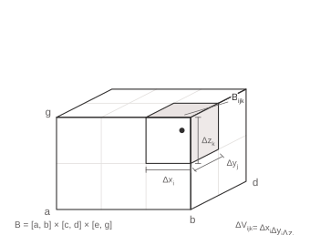
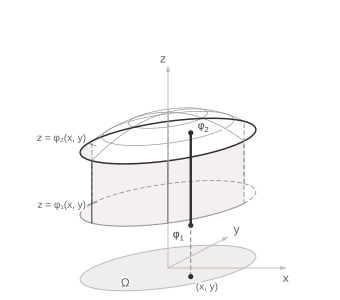
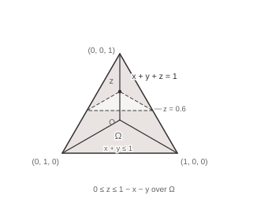

## Integration over a solid

A double integral accumulates a function over a plane region. A triple integral accumulates a function over a solid region in space. The construction is the same in one more dimension: the region is divided into small boxes, the function is evaluated in each box, the values are multiplied by the volumes of the boxes, and the sum is passed to a limit.

The interpretation is no longer a volume under a surface. If $f$ is a density, the triple integral is a mass; if $f=1$, it is the volume of the solid; if $f$ is a temperature, it is the total heat content relative to a reference. The definition does not depend on which interpretation is chosen.

## The integral over a box

Let $B=[a,b]\times[c,d]\times[e,g]$ be a closed rectangular box and let $f:B\to\mathbb{R}$ be bounded. A partition of $B$ is obtained by partitioning each of the three intervals. If the subintervals are

$$[x_{i-1},x_i],\qquad [y_{j-1},y_j],\qquad [z_{k-1},z_k]$$

then the partition divides $B$ into sub-boxes

$$B_{ijk}=[x_{i-1},x_i]\times[y_{j-1},y_j]\times[z_{k-1},z_k]$$

with volumes $\Delta V_{ijk}=\Delta x_i\,\Delta y_j\,\Delta z_k$. Choosing a sample point $(x_{ijk}^*,y_{ijk}^*,z_{ijk}^*)\in B_{ijk}$ gives the Riemann sum

$$S(f,P)=\sum_{i,j,k} f(x_{ijk}^*,y_{ijk}^*,z_{ijk}^*)\,\Delta V_{ijk}$$

The mesh $\lVert P\rVert$ is the largest diameter of a sub-box. The function is integrable over $B$ if these sums tend to a common limit as $\lVert P\rVert\to0$, independently of the sample points. The limit is the triple integral

$$\iiint_B f(x,y,z)\,dV=\lim_{\lVert P\rVert\to0}\sum_{i,j,k} f(x_{ijk}^*,y_{ijk}^*,z_{ijk}^*)\,\Delta V_{ijk} \tag{1}$$

As in the plane, the definition through Riemann sums is equivalent to one through lower and upper sums. With

$$m_{ijk}=\inf_{B_{ijk}}f \qquad M_{ijk}=\sup_{B_{ijk}}f$$

the lower and upper sums are

$$L(f,P)=\sum_{i,j,k}m_{ijk}\,\Delta V_{ijk} \qquad U(f,P)=\sum_{i,j,k}M_{ijk}\,\Delta V_{ijk}$$

and $f$ is integrable exactly when, for every $\varepsilon>0$, some partition satisfies

$$U(f,P)-L(f,P)<\varepsilon \tag{2}$$

The proof that the two definitions agree is the same as in one and two dimensions; only the indexing changes. Boundedness is again part of the definition. A continuous function on the compact box is uniformly continuous, so its oscillations on a fine partition are uniformly small and (2) holds. A bounded function that is discontinuous only on a finite union of surfaces of zero volume is also integrable.

## Properties

Let $f$ and $g$ be integrable on a box $B$ and let $\alpha,\beta\in\mathbb{R}$. Linearity, monotonicity and additivity carry over without change:

$$\iiint_B(\alpha f+\beta g)\,dV=\alpha\iiint_B f\,dV+\beta\iiint_B g\,dV$$

$$f\le g\ \text{on }B \quad\Longrightarrow\quad \iiint_B f\,dV\le\iiint_B g\,dV$$

If $B$ is split into two boxes that meet only on a face, the integrals add. The shared face has zero volume and contributes nothing. The same decomposition applies to more complicated solids, provided the pieces meet only on sets of zero volume.

The mean value inequality reads

$$m\,\operatorname{vol}(B)\le\iiint_B f\,dV\le M\,\operatorname{vol}(B)$$

when $m\le f\le M$ on $B$. If the integrand factors as a product of a function of each variable,

$$f(x,y,z)=g(x)h(y)k(z)$$

then over a box

$$\iiint_B f\,dV=\left(\int_a^b g(x)\,dx\right)\left(\int_c^d h(y)\,dy\right)\left(\int_e^g k(z)\,dz\right)$$

This is the three-dimensional product rule for integrals, and it follows by separating the sums in the Riemann definition or by applying the iterated-integral theorem twice.

## Solids that are not boxes

Let $D\subseteq\mathbb{R}^3$ be a bounded solid and let $B$ be a box containing $D$. Extend $f$ by zero outside $D$. The integral over $D$ is

$$\iiint_D f\,dV=\iiint_B f\,\chi_D\,dV \tag{3}$$

where $\chi_D$ is the indicator function of $D$. The extension is discontinuous on $\partial D$, so the integral exists whenever $f$ is bounded and continuous on $D$ and the boundary has zero volume. Balls, tetrahedra, cones, cylinders and solids bounded by finitely many continuous graphs all satisfy this condition.

The volume of $D$ is the integral of the constant function $1$:

$$\operatorname{vol}(D)=\iiint_D 1\,dV \tag{4}$$

This is consistent with the double integral of the height of a solid over its base. If $D$ lies between the graphs $z=\varphi_1(x,y)$ and $z=\varphi_2(x,y)$ over a plane region $\Omega$, then

$$\operatorname{vol}(D)=\iint_\Omega\bigl(\varphi_2(x,y)-\varphi_1(x,y)\bigr)\,dA$$

which is the volume-by-slicing formula from single-variable calculus, now derived from the triple integral.

A solid is called $z$-simple if every vertical line meets it in a single interval:

$$D=\{(x,y,z):(x,y)\in\Omega,\ \varphi_1(x,y)\le z\le\varphi_2(x,y)\}$$

where $\Omega$ is a plane region and $\varphi_1,\varphi_2$ are continuous on $\Omega$. The projection $\Omega$ is the shadow of $D$ on the $xy$-plane. A solid may also be $x$-simple or $y$-simple; the choice is a matter of which description gives the simplest limits.

## Iterated integrals

For a continuous function on a box, the triple integral equals any of the six iterated integrals obtained by ordering the three variables:

$$\iiint_B f\,dV=\int_a^b\int_c^d\int_e^g f(x,y,z)\,dz\,dy\,dx \tag{5}$$

with the obvious variants in the order of integration. This is the three-dimensional case of [Fubini's theorem](../fubinis-theorem/), which also gives the precise hypotheses and the passage to more general regions. For a $z$-simple solid, the formula becomes

$$\iiint_D f\,dV=\iint_\Omega\left(\int_{\varphi_1(x,y)}^{\varphi_2(x,y)} f(x,y,z)\,dz\right)dA \tag{6}$$

The inner integral is a double integral over the shadow $\Omega$, which is then evaluated by the methods for [double integrals](../double-integrals/).

## A cube

Evaluate

$$\iiint_B(x+y+z)\,dV \qquad B=[0,1]^3$$

Separating the three terms,

$$\int_0^1\int_0^1\int_0^1 x\,dz\,dy\,dx=\frac12$$

and the same value arises from the $y$ and $z$ terms. Hence the integral is $3/2$. The product structure confirms the result: each single integral of $t$ over $[0,1]$ equals $1/2$, and the sum of the three contributions is $3/2$.

## A tetrahedron

Let

$$T=\{(x,y,z):x\ge0,\ y\ge0,\ z\ge0,\ x+y+z\le1\}$$

This is the standard tetrahedron with vertices $(0,0,0)$, $(1,0,0)$, $(0,1,0)$ and $(0,0,1)$. Evaluate

$$\iiint_T z\,dV$$

The solid is $z$-simple over the triangle $\Omega=\{x\ge0,\ y\ge0,\ x+y\le1\}$ in the plane, with $0\le z\le1-x-y$. Therefore

$$\iiint_T z\,dV=\iint_\Omega\left(\int_0^{1-x-y}z\,dz\right)dA=\frac12\iint_\Omega(1-x-y)^2\,dA$$

The remaining double integral is

$$\frac12\int_0^1\int_0^{1-x}(1-x-y)^2\,dy\,dx=\frac12\int_0^1\frac{(1-x)^3}{3}\,dx=\frac12\cdot\frac{1}{12}=\frac{1}{24}$$

As a check, the volume of $T$ is

$$\iiint_T1\,dV=\iint_\Omega(1-x-y)\,dA=\int_0^1\frac{(1-x)^2}{2}\,dx=\frac16$$

The centroid of a tetrahedron with uniform density has coordinates $(1/4,1/4,1/4)$ by symmetry. The computation confirms the $z$-coordinate:

$$\bar z=\frac{1}{\operatorname{vol}(T)}\iiint_T z\,dV=\frac{1/24}{1/6}=\frac14$$

## A solid with variable density

Let a unit cube have density $\rho(x,y,z)=1+z$. Its mass is

$$M=\int_0^1\int_0^1\int_0^1(1+z)\,dz\,dy\,dx=1+\frac12=\frac32$$

The first moment in $z$ is

$$\iiint_B z(1+z)\,dV=\int_0^1\left(\frac12+\frac13\right)dx=\frac56$$

so the $z$-coordinate of the centre of mass is

$$\bar z=\frac{5/6}{3/2}=\frac59$$

The density increases with height, so the centre of mass lies above the geometric centre $z=1/2$. The other two coordinates remain $1/2$ by symmetry.

## Mass, centre of mass and average value

For a solid $D$ with density $\rho(x,y,z)$, the triple integral gives the mass and the moments:

$$M=\iiint_D\rho\,dV \qquad \bar x=\frac1M\iiint_D x\rho\,dV \qquad \bar y=\frac1M\iiint_D y\rho\,dV \qquad \bar z=\frac1M\iiint_D z\rho\,dV$$

When the density is constant, the centre of mass is the centroid of $D$, computed from the volume and the first moments. The average value of a function over $D$ is

$$\bar f=\frac{1}{\operatorname{vol}(D)}\iiint_D f\,dV$$

provided the volume is positive. These formulas are the three-dimensional versions of the area and average-value formulas for [double integrals](../double-integrals/). They require the same integrability hypotheses and the same care about the boundary.

## When the definition fails

The failure modes are the same as in the plane, with one new feature: the order of iteration can conceal a divergence.

An unbounded function is not Riemann integrable over a box. The function $f(x,y,z)=1/(x+y+z)$ on $(0,1]^3$ is unbounded near the origin. Its integral can be defined as an improper integral by exhausting the box, but the result depends on the exhaustion in general and is not a Riemann integral.

A bounded function can fail to be integrable through oscillations. The function equal to $1$ when $x$ is rational and $0$ otherwise is not integrable on any box, because every sub-box contains points with rational and irrational $x$.

A more subtle point concerns iterated integrals. If $f$ is integrable and the sections are integrable, all orders of iteration give the same value by Fubini's theorem. If $f$ is not integrable, an iterated integral may still exist, and different orders may produce different values. The standard example is

$$f(x,y)=\frac{x^2-y^2}{(x^2+y^2)^2}$$

on the unit square. The iterated integrals, taken as improper integrals, are $\pi/4$ and $-\pi/4$. The function is unbounded near the origin and is not Riemann integrable, so neither value is the integral of $f$ over the square. The example is discussed in the entry on [Fubini's theorem](../fubinis-theorem/), where the hypotheses that exclude it are stated.

## Relation to the other integral notions

The triple integral is the three-dimensional Riemann integral. Its definition is the direct analogue of the [double integral](../double-integrals/), and its evaluation rests on the same iterated-integral theorem. For solids with rotational symmetry, Cartesian coordinates produce complicated limits and integrands. [Cylindrical coordinates](../cylindrical-coordinates/) and [spherical coordinates](../spherical-coordinates/) replace the volume element by $r\,dr\,d\theta\,dz$ and $\rho^2\sin\varphi\,d\rho\,d\varphi\,d\theta$ respectively. Those substitutions are instances of the general [change of variables](../change-of-variables-in-multiple-integrals/) formula, which also justifies the Jacobian factors in more general transformations.
